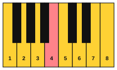
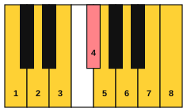
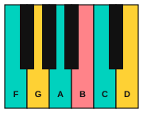

# Lydian and the sound of wonder

<span class="tag tag-piano">Piano</span>

After this lesson you can play the F Lydian scale and the C Lydian scale, play the two-chord pattern that goes with them, and play an original piece, Lantern Rise, in F Lydian.

Before this: [The modes](01-modes.md), [Hearing the modes](02-hearing-modes.md), [Triads](../04-intervals-and-triads/04-triads.md), [Hands together](../02-two-hands-and-first-chords/03-hands-together.md). You need: your piano.

## The idea

### The raised 4th

Lydian is the major scale with one change: the 4th note is raised by a half step. In C major the 4th is F. In C Lydian it is F#. The scale is C, D, E, F#, G, A, B, C. The raised 4th sits a half step below the 5th, so it leans up toward G instead of down toward E. That lean gives Lydian a floating, open sound, and it is the sound film and game composers often use for wonder, flight and discovery.

The white-key Lydian starts on F. The notes are F, G, A, B, C, D, E, F, with no sharps or flats, because the B natural is the raised 4th above F. The B is the note to listen for.



The C Lydian scale is the one with a black key: C, D, E, F#, G, A, B, C. Play it once, then play the C major scale, and listen to the one note that changes.



### Chords I and II

A chord pattern shows off Lydian best. In a major key, the chord on the 2nd degree is normally minor. In F major it is Gm (G, Bb, D). The Bb is the flat note of F major. In F Lydian the Bb becomes B natural, so the chord on the 2nd degree is a major chord: G major is G, B, D. The B in that chord is the #4 of F, so every time the pattern moves from F to G, the colour note appears in the chord itself.

Chords are named by Roman numerals in a key, as you will learn in [Roman numerals](../09-harmony/01-roman-numerals.md): I for the chord on the 1st degree, II for the chord on the 2nd. The I-II pattern here is F then G, in F Lydian. Play the two chords as triads, then as open fifths.



### How to practise it

Follow these steps.

1. Put your left hand on F2 and C3 (finger 5 on F, finger 1 on C), the open fifth of F.
2. Hold it for two bars, then move to G2 and D3 (finger 5 on G, finger 1 on D) for two bars. Listen for the small brightening when the B arrives in the G chord.
3. Add the right hand, one note per bar, from the F Lydian scale: A4, C5, B4, F5. Hold each note while the chord plays under it.
4. When the right hand is steady, play the melody in Lantern Rise below.

Common mistake at step 3: playing a Bb from habit. The black key is the wrong note here. If you hear it, the sound turns back to ordinary major, so move your finger to B natural.

## Hear and see

Lantern Rise is an original piece for this book. It is 8 bars in 4/4 at 66 bpm. The key is F Lydian, written on the white keys with no key signature, so F is home. The left hand plays the I-II pattern: F in bars 1 to 2 and 5 to 6, G in bars 3 to 4 and 7, and a last F in bar 8. The pedal is optional in this piece. Listen for the B in bars 3 and 7.

```abc
X:1
T:Lantern Rise
C:Original, for this book
M:4/4
L:1/4
Q:1/4=66
K:C
%%score {RH LH}
V:RH clef=treble
V:LH clef=bass
[V:RH] A2 c2 | f2 e c | d2 B2 | B A G2 |
[V:LH] [F,,C,]4 | [F,,C,]4 | [G,,D,]4 | [G,,D,]4 |
[V:RH] A2 c2 | f2 a2 | g e d B | c A F2 |]
[V:LH] [F,,C,]4 | [F,,C,]4 | [G,,D,]4 | [F,,C,]4 |]
```

Learn it in two sections of four bars.

| Bars | Chord | What to learn |
|---|---|---|
| 1 to 4 | F, then G | The rising A and C, then the B in bar 3 |
| 5 to 8 | F, then G, then F | The high A in bar 6, the falling line in bar 7, and the F at the end |

Play the right hand alone first, then the left hand alone, then both. Keep the left hand softer than the right.

If a hand, wrist or arm aches, stop and rest. If it keeps happening, see a teacher or a doctor.

## Try it

Exercise 1. Spell the F Lydian scale, and name its characteristic note.

<details class="solution" markdown>
<summary>Answer</summary>

The F Lydian scale: F, G, A, B, C, D, E, F. The characteristic note is B, the #4.

</details>

Exercise 2. Spell the G major chord, and say which note is the #4 of F Lydian.

<details class="solution" markdown>
<summary>Answer</summary>

G major: G, B, D. The B is the #4 of F Lydian.

</details>

Exercise 3. The C Lydian scale has one black key. Which note is it, and what is the matching note in C major?

<details class="solution" markdown>
<summary>Answer</summary>

F#, the raised 4th. In C major the matching note is F natural.

</details>

<div class="practice" markdown>

### Practice routine (30 minutes)

| Minutes | What to do | Tempo | Listen for |
|---|---|---|---|
| 5 | Warm-up: F Lydian scale, right hand, one octave up and down over a held left-hand F and C | 66 bpm | The B natural, and no Bb |
| 15 | New skill: the F and G open fifths in the left hand, then Lantern Rise in two sections, hands separately, then together | 60 bpm, then 66 | A steady left hand under the melody |
| 5 | Review: Example 2 from lesson 1, D Dorian over the D and A fifth | 66 bpm | The same keys sounding different |
| 5 | Guitar: C and G chords, changing every bar | 60 bpm | Every string ringing |

Repeat this routine on at least three days before you check the boxes below.

</div>

<div class="move-on" markdown>

### Move on when

- [ ] You can play the F Lydian scale up and down with the right hand over a held F and C at 66 bpm, with no Bb.
- [ ] You can play the C Lydian scale up and down with the right hand at 66 bpm, three times in a row.
- [ ] You can play Lantern Rise at 66 bpm, hands together, three times in a row with no stops.
- [ ] You can name the B in the G chord as the #4 of F.

</div>

## Common mistakes

Playing the B flat from habit. The key of F major has a Bb, but F Lydian does not. If the sound feels ordinary, check for it.

Letting the left hand lead. The fifths are the background. Play them softer than the melody and let them ring.

Treating G as a different key. The G chord belongs to F Lydian. The tune stays in F, and the chord adds the B colour.

## Key terms

- **Lydian**: the mode that is the major scale with a raised 4th (#4).
- **I-II pattern**: a chord pattern that alternates the chord on degree 1 with the major chord on degree 2, which in Lydian contains the #4.

Next: [Left-hand patterns for improvising](04-left-hand-patterns-for-improvising.md)
