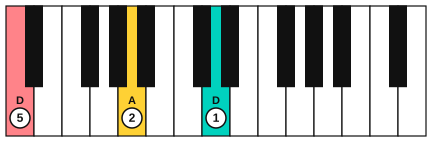

# Left-hand patterns for improvising

<span class="tag tag-piano">Piano</span>

After this lesson you can play four steady left-hand patterns on D (a drone, an open fifth, a broken fifth and a two-chord vamp), and loop each one with the play bar to improvise over.

Before this: [Left-hand C position](../02-two-hands-and-first-chords/02-left-hand-c-position.md), [Alberti bass and waltz bass](../07-pedal-texture-and-ambient/04-alberti-and-waltz-bass.md), [Ambient piano](../07-pedal-texture-and-ambient/05-ambient-piano.md), [Lydian and the sound of wonder](03-lydian-wonder.md). You need: your piano.

## The idea

### Why the left hand comes first

To improvise, one hand has to be steady without thinking so the other can wander. The left hand's job is to repeat a pattern that tells the ear where home is, and to keep the beat. If the pattern stays the same, the right hand can try ideas and fail safely: whatever it plays is heard against a firm background.

This lesson gives you four patterns on D, the home note for D Dorian in the next lesson. They go from the simplest to a pattern with two chords. Each is a backing loop: an example you play with the play bar's loop button turned on, so it repeats while you play along.

### Four patterns

A **drone** is one note held for a long time. On the piano, play the low D with finger 5 and hold it with the damper pedal if you like. It has no rhythm to follow, so it is the easiest to improvise over. Its weakness is that it has no motion.

An **open fifth** is a root and the note a fifth above it, with no third. For D it is D and A. Play both together with fingers 5 and 1 and hold them. It is neither major nor minor, so every note of D Dorian, which has a minor 3rd, works over it.

A **broken fifth** plays the root, the fifth, the octave and the fifth again, one at a time. For D that is D2, A2, D3, A2. It keeps a steady beat of four, and it is the left-hand version of the 1-5-8-5 pattern in [Broken-chord accompaniment](../05-minor-keys-and-chord-charts/11-broken-chord-accompaniment.md).

A **vamp** is a short pattern of one or two chords that repeats as long as you like. Here the vamp is D, then G: two bars on D, then one bar on G, then back to D. The G chord has a B in it, which is the natural 6 of D Dorian, so this vamp makes the Dorian colour part of the left hand.



### Fingering

For the open fifth, put finger 5 on D2 and finger 1 on A2 and press them together. For the broken fifth, use fingers 5, 2, 1, 2 on D2, A2, D3, A2. If the octave from D2 to D3 is a stretch, stay relaxed, roll the notes without hurry, and stop if your hand aches.

For the G in the vamp, play G2, D3, G3, D3 with fingers 5, 2, 1, 2 (G2 is a step below A2, so the shape slides one white key to the left).

### How to loop

The play bar on each example has a loop button. Turn it on and the example repeats. Use the tempo slider to slow it down if you need to. Start with the left hand alone until the pattern needs no thought, then play a single right-hand note on each bar.

## Hear and see

Each loop is four bars in 4/4 at 66 bpm, in the bass clef. The pedal is optional: if you use it, change it when the chord changes.

Example 1: the drone. Four bars of the low D held.

```abc
X:1
M:4/4
L:1/4
Q:1/4=66
K:C clef=bass
D,,4 | D,,4 | D,,4 | D,,4 |]
```

Example 2: the open fifth. D and A together, held.

```abc
X:1
M:4/4
L:1/4
Q:1/4=66
K:C clef=bass
[D,,A,,]4 | [D,,A,,]4 | [D,,A,,]4 | [D,,A,,]4 |]
```

Example 3: the broken fifth. D, A, D, A, with fingers 5, 2, 1, 2 in each bar.

```abc
X:1
M:4/4
L:1/4
Q:1/4=66
K:C clef=bass
!5!D,, !2!A,, !1!D, A,, | D,, A,, D, A,, | D,, A,, D, A,, | D,, A,, D, A,, |]
```

Example 4: the vamp. D for two bars, G for one bar, D for the last bar. Listen for the B in the G chord when you play it with the right hand later.

```abc
X:1
M:4/4
L:1/4
Q:1/4=66
K:C clef=bass
D,, A,, D, A,, | D,, A,, D, A,, | G,, D, G, D, | D,, A,, D, A,, |]
```

Common mistake: speeding up when you add the right hand. If the loop starts to run away, stop the right hand, bring the left hand back to 66 bpm, and add one right-hand note per bar. The loop is the clock, so keep your left hand with it.

## Try it

Exercise 1. Name the two notes of the open fifth on D, and say why it works with a minor 3rd.

<details class="solution" markdown>
<summary>Answer</summary>

D and A. It has no 3rd, so it is neither major nor minor, and the 3rd in the right hand can be minor (F) without a clash.

</details>

Exercise 2. In Example 4, which bars are on D and which is on G?

<details class="solution" markdown>
<summary>Answer</summary>

Bars 1, 2 and 4 are on D, and bar 3 is on G.

</details>

Exercise 3. Which note in the G chord is the natural 6 of D Dorian?

<details class="solution" markdown>
<summary>Answer</summary>

B. The G chord is G, B, D, and B is the 6th note above D.

</details>

<div class="practice" markdown>

### Practice routine (30 minutes)

| Minutes | What to do | Tempo | Listen for |
|---|---|---|---|
| 5 | Warm-up: the open fifth D and A, then the drone, then the broken fifth, each for four bars with the left hand alone | 66 bpm | A steady beat with no rushing |
| 15 | New skill: loop Example 4 with the play bar and play the left-hand vamp along with it, then play one right-hand note from the white keys D to D on each bar | 66 bpm, then 60 | The left hand matching the loop exactly |
| 5 | Reading: Lantern Rise from lesson 3, hands together | 66 bpm | The left hand softer than the melody |
| 5 | Guitar: Dm and G chords, changing every bar | 60 bpm | A clean change with no gap |

Repeat this routine on at least three days before you check the boxes below.

</div>

<div class="move-on" markdown>

### Move on when

- [ ] You can play Examples 2, 3 and 4 with the left hand at 66 bpm, four bars each, with no stops.
- [ ] You can play the left hand of Example 4 along with the loop for 16 bars in a row.
- [ ] You can add one right-hand note per bar from the white keys D to D and keep the left hand steady.

</div>

## Common mistakes

Playing the pattern too loudly. The right hand needs to be heard over it, so keep the left hand at p.

Changing the pattern while you improvise. The left hand is the backdrop. Pick one pattern and stay with it until the right hand is comfortable.

Holding the pedal through the chord change. If you use the pedal in the vamp, change it as the left hand moves from D to G, or the two chords will blur.

## Key terms

- **Drone**: a single note held for a long time as a home note.
- **Open fifth**: a root and the note a fifth above it, with no third.
- **Broken fifth**: the root, fifth, octave and fifth played one at a time, in a steady rhythm.
- **Vamp**: a short chord pattern, usually one or two chords, repeated as long as needed.
- **Backing loop**: an example you play with the loop button on while you improvise over it.

Next: [Improvise in Dorian](05-improvise-in-dorian.md)
