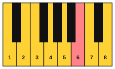

# Improvise in Dorian

<span class="tag tag-improvise">Improvising</span>

After this lesson you can improvise a short phrase in D Dorian over a drone or a two-chord vamp, using a motif, and finish it on D.

Before this: [The modes](01-modes.md), [Hearing the modes](02-hearing-modes.md), [Left-hand patterns for improvising](04-left-hand-patterns-for-improvising.md). You need: your piano, and a way to record yourself (a phone is fine).

## The idea

### What improvising is

To **improvise** is to make up music as you play it. It is a skill, and like any skill it comes in small steps. You do not need to invent a great tune. The first goal is to play a few notes that fit the backing, listen to them, and play a few more. Wrong notes are part of the process: each one tells you something about the sound, and a good player uses them. If one lands badly, move to the next note up or down and keep the beat.

The space is small on purpose: a few notes allowed, a backing loop, and three rules. Inside it, every note fits, so you can try things safely.

### The notes allowed

D Dorian on the white keys: D, E, F, G, A, B, C, D. Use the octave from D4 to D5 first. These eight notes are the only ones you play. Because every note is on a white key, any note you choose fits the D drone, so none of them is wrong.



The notes that sound most restful over a D drone are D, F and A (the D minor chord) and the notes close to them. The B is the colour note. The E and C are passing notes, which are best used to step between the restful ones.

### The backing loops

You loop one of the two patterns from the last lesson with the play bar. Turn the loop button on and start with the slower one.

Loop A: the open fifth. Four bars of D and A. This is the safest loop, because nothing in it changes.

```abc
X:1
M:4/4
L:1/4
Q:1/4=66
K:C clef=bass
[D,,A,,]4 | [D,,A,,]4 | [D,,A,,]4 | [D,,A,,]4 |]
```

Loop B: the vamp. D for two bars, G for one, D for one. Over the G bar, the B is a chord note and sounds most at home.

```abc
X:1
M:4/4
L:1/4
Q:1/4=66
K:C clef=bass
D,, A,, D, A,, | D,, A,, D, A,, | G,, D, G, D, | D,, A,, D, A,, |]
```

### Three rules for the first try

1. Play only the notes D, E, F, G, A, B, C and D, and begin and end on D.
2. Play a short idea of two to four notes, then rest for at least one beat. Do not fill every beat.
3. Play your idea twice, and change the last note the second time.

### What a motif is

A **motif** is a short musical idea, usually two to five notes, that you repeat and change. Almost every tune is built from one. Rule 3 above is how you use one: say it, say it again with a small change, and let the change be the answer. For example, the motif D, F, A (rising in steps of a third) could come back as D, F, G, so the second time it stops one note lower.

A motif has a rhythm as well as notes. Keep the rhythm the same and change the notes, or keep the notes and change the rhythm. Either way the ear hears the idea coming back.

### Steps for the first try

1. Turn on Loop A and play the left hand along with it. Hold a single D in the right hand, one octave above the low D, to hear it against the drone.
2. Play only D, F and A, in any order, one at a time, with rests. These three are the D minor chord and are safe.
3. Add E and G to connect them: D E F, F G A. Listen to how each note leans.
4. Add B once, on a long note. Listen to how it brightens the minor sound.
5. Switch to Loop B and put the B on the bar where the loop plays G.

Common mistake at step 3: playing fast to avoid the silence. The silence is where you hear the loop. Slow down, play fewer notes and let each one ring.

## Hear and see

Here is an example improvisation over Loop B, repeated twice. It is eight bars. Bars 1 and 2 are the motif (rest, D, F, A, then G and F), bars 3 and 4 answer with the B over the G chord, bars 5 and 6 move the idea higher, and bars 7 and 8 come home to D. Play along, then change it.

```abc
X:1
M:4/4
L:1/4
Q:1/4=66
K:C
%%score {RH LH}
V:RH clef=treble
V:LH clef=bass
[V:RH] z D F A | G2 F2 | z D G B | A4 |
[V:LH] D,, A,, D, A,, | D,, A,, D, A,, | G,, D, G, D, | D,, A,, D, A,, |
[V:RH] z A c d | c2 A2 | B2 A G | D4 |]
[V:LH] D,, A,, D, A,, | D,, A,, D, A,, | G,, D, G, D, | D,,4 |]
```

Look at how the motif works. Bar 1 is z D F A (rest, then a rising shape). Bar 3 is z D G B, which keeps the shape but changes the last two notes to G and B. Bar 5 is z A c d, the same shape one step higher. The ear follows the rest and the rise, so it hears three versions of one idea.

Record yourself playing over a loop for one minute, then listen back. Find one moment you like and play it again.

## Try it

Exercise 1. Which three notes of D Dorian make the D minor chord?

<details class="solution" markdown>
<summary>Answer</summary>

D, F and A.

</details>

Exercise 2. In the example, which bar plays the natural 6, and which chord is under it?

<details class="solution" markdown>
<summary>Answer</summary>

Bar 3 plays the B (and bar 7 plays it again). The left hand is on G in both bars.

</details>

Exercise 3. Make up a motif of three notes using only D, F and A, and write the notes down. Then change its last note.

<details class="solution" markdown>
<summary>Answer</summary>

Many answers work. One: D, F, A, then D, F, G. Any version that starts with the same two notes and ends on a different third note is a variation.

</details>

<div class="practice" markdown>

### Practice routine (30 minutes)

| Minutes | What to do | Tempo | Listen for |
|---|---|---|---|
| 5 | Warm-up: left-hand vamp from Loop B along with the play bar, 8 bars | 66 bpm | A steady left hand |
| 15 | New skill: improvise over Loop A for 5 minutes with the three rules, then over Loop B for 5 minutes, then play the example improvisation and change two notes in it | 66 bpm, then 60 | The silences, and the B over the G bar |
| 5 | Ear: play Examples 1 and 2 of lesson 2 and name the modes | Untimed | The natural 6 in Dorian |
| 5 | Guitar: Em and Am chords, changing every bar | 60 bpm | Every string ringing |

Repeat this routine on at least three days before you check the boxes below. Make up something new each time.

</div>

<div class="move-on" markdown>

### Move on when

- [ ] You can improvise 8 bars over Loop B with only the notes D to D, starting and ending on D, with no stops.
- [ ] You can play a motif of 3 or 4 notes and repeat it with one changed note, on two bars in a row.
- [ ] You can record a 1-minute improvisation over the loop and point to one phrase you would keep.
- [ ] You can play the B over the G bar in at least half of your loops.

</div>

## Common mistakes

Filling every beat. A phrase needs rests to be heard. Count a beat of silence after each idea.

Stopping at a wrong note. Keep the beat, play the next note, and use the odd note as a motif if it sounds interesting.

Wandering without a home. Begin and end on D, and come back to D after every few bars. That is how the ear knows the mode.

## Key terms

- **Improvise**: to make up music while playing it.
- **Motif**: a short musical idea that is repeated and changed.

Next: [Improvise in Lydian](06-improvise-in-lydian.md)
