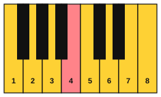

# Improvise in Lydian

<span class="tag tag-improvise">Improvising</span>

After this lesson you can improvise a short rising phrase in F Lydian over the F and G pattern, land on the B over the G chord, and finish on F.

Before this: [Lydian and the sound of wonder](03-lydian-wonder.md), [Left-hand patterns for improvising](04-left-hand-patterns-for-improvising.md), [Improvise in Dorian](05-improvise-in-dorian.md). You need: your piano, and a way to record yourself.

## The idea

### The notes allowed

F Lydian on the white keys: F, G, A, B, C, D, E, F. Play the octave from F4 to F5 first, then reach up to A5 and down to C4 when you are comfortable. Never play Bb. There is no black key in this mode, and the note to watch for is the Bb of F major, which your hand may reach for out of habit.



The F chord is F, A, C and the G chord is G, B, D. Over the F bars, the notes F, A and C sound most settled. Over the G bars, G, B and D do. The B is the colour note: it is the #4 of F, and in the G chord it sits as a chord note, so it sounds natural there.

### The backing loop

The loop is the I-II pattern from lesson 3 with the left-hand broken fifth from lesson 4, moved to F and G. It has four bars: F for two, G for two. Turn on the play bar's loop button.

```abc
X:1
M:4/4
L:1/4
Q:1/4=66
K:C clef=bass
F,, C, F, C, | F,, C, F, C, | G,, D, G, D, | G,, D, G, D, |]
```

For a slower start, hold the open fifths F and C, then G and D, as whole notes. Everything in this lesson works over either.

### Three rules for the first try

1. Play only F, G, A, B, C, D and E, and begin and end on F, A or C.
2. Play the B at least once over the G chord, and hold it long enough to hear it.
3. Move up for the first phrase and down for the second, as if asking and then settling.

### Why up, then down

Lydian has the sound of looking up and out. A phrase that rises and lands on a high held note matches that sound. A phrase that falls back to F brings it home. If both phrases rise or both fall, the ear has nowhere to rest.

### Steps for the first try

1. Turn on the loop and play the left hand along with it. Do not worry about the right hand yet.
2. Play single notes with the right hand, one per bar: A, C, F, A. All of them belong to the F chord.
3. Add the B on a G bar, in the right hand, as a long note. Listen to it brighten.
4. Make a motif of three notes that rises, such as A, C, E, and play it over two bars.
5. Play it again one step higher, and finish with a falling line to F.

Common mistake at step 3: sliding from the B to a Bb out of habit from F major. Listen for the open, bright sound, and move back to B natural by ear.

## Hear and see

Here is an example improvisation over the loop, eight bars. The first four bars rise (A and C, then F, then the B over G). The second four bars fall (C down to A, then a high G over the G chord, then F5 as the last note).

```abc
X:1
M:4/4
L:1/4
Q:1/4=66
K:C
%%score {RH LH}
V:RH clef=treble
V:LH clef=bass
[V:RH] A2 c2 | A c f2 | e d B2 | A B d2 |
[V:LH] F,, C, F, C, | F,, C, F, C, | G,, D, G, D, | G,, D, G, D, |
[V:RH] c2 A2 | G A c2 | d B d g | f4 |]
[V:LH] F,, C, F, C, | F,, C, F, C, | G,, D, G, D, | F,,4 |]
```

Look at the shape. Bars 1 and 2 climb from A and C to the high F. Bar 3 steps down E, D, B, and bar 4 rises again A, B, D, so the B lands on the G chord twice in a row. Bars 5 and 6 fall back to C. Bar 7 jumps D, B, D, G over the G chord, and bar 8 finishes on a long F. The long notes are where the loop is easiest to hear.

Record yourself for one minute over the loop. Listen for the places where the B lands on a G bar.

## Try it

Exercise 1. Spell the F chord and the G chord, and say which note of the G chord is the colour note of F Lydian.

<details class="solution" markdown>
<summary>Answer</summary>

F: F, A, C. G: G, B, D. The B is the colour note, the #4 of F.

</details>

Exercise 2. In the example, which bars play the B, and which chord is under them?

<details class="solution" markdown>
<summary>Answer</summary>

Bars 3, 4 and 7 play the B. The chord under all three is G.

</details>

Exercise 3. Make up a rising phrase of four notes that ends on the B, using only F Lydian notes.

<details class="solution" markdown>
<summary>Answer</summary>

Many answers work. One: F, A, D, B. Any rising line that ends on B and uses only F, G, A, B, C, D and E is correct.

</details>

<div class="practice" markdown>

### Practice routine (30 minutes)

| Minutes | What to do | Tempo | Listen for |
|---|---|---|---|
| 5 | Warm-up: the loop's left hand along with the play bar, 8 bars | 66 bpm | A steady left hand |
| 15 | New skill: improvise over the loop for 5 minutes with the three rules, then for 5 minutes with a different first note, then play the example and change two notes | 66 bpm, then 60 | The B over the G bars, and the final F |
| 5 | Ear: play lesson 2 Examples 3 and 6 and say which has the #4 | Untimed | The lean up from the #4 |
| 5 | Guitar: C and G chords, changing every bar | 60 bpm | Every string ringing |

Repeat this routine on at least three days before you check the boxes below.

</div>

<div class="move-on" markdown>

### Move on when

- [ ] You can improvise 8 bars over the loop, starting and ending on F, with the B played over the G bars, with no stops.
- [ ] You can play a rising phrase and a falling phrase over four bars each.
- [ ] You can record a 1-minute improvisation and find one phrase you would play again.
- [ ] You can spot a Bb in your own playing and move off it by ear.

</div>

## Common mistakes

Going back to F major by habit. The Bb is always the wrong note in this lesson. Keep your fourth finger off the black key.

Playing the same phrase every time. Change the first note or the rhythm each time you loop.

Ignoring the chord. When the loop moves to G, aim for a note of that chord at the start of the bar, and then walk to the next.

## Key terms

- **Phrase**: a short musical idea that feels like a sentence, such as four bars with a rise and a fall.

Next: [Ambient improvising](07-ambient-improvising.md)
