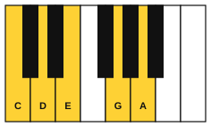

# Ambient improvising

<span class="tag tag-improvise">Improvising</span>

After this lesson you can improvise a slow, quiet melody of a few notes over a chord loop, with the damper pedal held across the bar and silence used on purpose.

Before this: [Ambient piano](../07-pedal-texture-and-ambient/05-ambient-piano.md), [Legato pedalling](../07-pedal-texture-and-ambient/02-legato-pedalling.md), [Improvise in Dorian](05-improvise-in-dorian.md), [Improvise in Lydian](06-improvise-in-lydian.md). You need: your piano with its damper pedal, and a way to record yourself.

## The idea

### Less is the point

In the ambient piece in stage 7, the melody had few notes and long rests, and the pedal let the chords ring. Improvising in that style is the easiest kind to start with, because slow music gives you time to listen and decide. Every note matters, so you play fewer of them.

Three things make it work. You play very few notes. You let each note sound until it fades. And you leave space, so the held chord can be heard.

### The notes allowed

Five notes: C, D, E, G and A. Play them in any octave from C4 to C6. They fit all four chords in the loop below, and no two of them are a half step apart, so they do not rub against each other. The E against the F chord is the gentlest rub (a major 7th), and in this slow style it sounds soft. A set of five notes like this is a pentatonic scale, and lesson 8 gives the idea its name.



### The backing loop

The loop is eight bars at 54 bpm. Each chord lasts two bars: the left hand plays it in the first bar and rests in the second while the pedal holds it. The chords are Cadd9 (C, G, D), Fadd9 (F, C, G), Am add9 (A, E, B) and Gadd9 (G, D, A), the same four chords as Still Water. Press the pedal after each chord, and change it right after the next one, as in lesson 2 of stage 7.

```abc
X:1
M:4/4
L:1/4
Q:1/4=54
K:C clef=bass
"_Ped."[C,,G,,D,]4- | [C,,G,,D,]4 | "_*Ped."[F,,C,G,]4- | [F,,C,G,]4 |
"_*Ped."[A,,E,B,]4- | [A,,E,B,]4 | "_*Ped."[G,,D,A,]4- | [G,,D,A,]4 |]
```

The play bar has no pedal, so the loop writes each chord as a note tied across two bars. When you play the left hand yourself, play the chord once and hold it with the pedal for two bars.

### Three rules for the first try

1. Play only C, D, E, G and A, softly (p or pp).
2. Play no more than three notes in a bar.
3. After each idea, stop and listen to the sound fade for at least two beats before you play again.

### Using the pedal

When you play yourself, put the left-hand chord down and press the pedal right after it, as in stage 7. Play right-hand notes on top without lifting. The notes blend with the chord and with one another. Change the pedal when the next chord arrives, right after its low note, to avoid mud.

If the sound blurs, your pedal is down too long. Lift it, let the sound clear, and press it again.

### Steps for the first try

1. Play the loop with the left hand and pedal alone, listening to the chords.
2. Play one right-hand note per two-bar chord, high up, such as E5 over the C chord. Let it ring.
3. Add a second note a step or a third away in the second bar of each chord.
4. Try a rest as the second note: play one note, then silence, then one note.
5. Record a minute, then listen back to the silences.

Common mistake at step 3: adding notes to avoid the quiet. The quiet is the style. Keep to three notes or fewer per bar.

## Hear and see

Here is an example improvisation over the loop. It is eight bars at 54 bpm. Every note is one of the five, every bar has three notes or fewer, and six of the eight bars have a single note. The final D sits over the G chord and leads back to the C chord at the loop point.

```abc
X:1
M:4/4
L:1/4
Q:1/4=54
K:C
%%score {RH LH}
V:RH clef=treble
V:LH clef=bass
[V:RH] !pp!z2 E2 | G3 z | z A2 G | E4 |
[V:LH] "_Ped."[C,,G,,D,]4- | [C,,G,,D,]4 | "_*Ped."[F,,C,G,]4- | [F,,C,G,]4 |
[V:RH] z2 c2 | d3 z | z A G E | D4 |]
[V:LH] "_*Ped."[A,,E,B,]4- | [A,,E,B,]4 | "_*Ped."[G,,D,A,]4- | [G,,D,A,]4 |]
```

Play the example once as written and then change it. Move a note, or swap two, or take one away. The changes are your improvisation.

If a hand, wrist, arm or foot aches, stop and rest. If it keeps happening, see a teacher or a doctor.

## Try it

Exercise 1. Which five notes are allowed, and what pedal rule goes with them?

<details class="solution" markdown>
<summary>Answer</summary>

C, D, E, G and A. Press the pedal after the chord and change it right after the next chord arrives.

</details>

Exercise 2. In the example, how many right-hand notes are in bar 3, and how many beats of rest are in the bar?

<details class="solution" markdown>
<summary>Answer</summary>

Two notes: A for two beats and G for one beat. The quarter rest at the start is the one beat of rest.

</details>

Exercise 3. Make up a three-note idea with a rest in it, using only the five notes, and play it over one chord.

<details class="solution" markdown>
<summary>Answer</summary>

Many answers work. One: E (2 beats), rest (1 beat), G (1 beat), then silence for the next bar.

</details>

<div class="practice" markdown>

### Practice routine (30 minutes)

| Minutes | What to do | Tempo | Listen for |
|---|---|---|---|
| 5 | Warm-up: the four left-hand chords one after another with the pedal changed after each new low note | 54 bpm | The old chord disappearing cleanly |
| 15 | New skill: improvise over the loop for 5 minutes with the three rules, then for 5 minutes with fewer notes, then play the example and change two bars | 54 bpm | Silence counted in the rests |
| 5 | Ear: lesson 2 Examples 1 to 3, naming the modes | Untimed | The altered notes |
| 5 | Guitar: Asus2 and Dsus2 chords, one strum per bar, letting them ring | 54 bpm | Every string ringing |

Repeat this routine on at least three days before you check the boxes below.

</div>

<div class="move-on" markdown>

### Move on when

- [ ] You can improvise 8 bars over the loop using only the five notes, with no more than three notes in any bar.
- [ ] You can leave at least two beats of silence after each idea without speeding up.
- [ ] You can record one minute of ambient improvising and hear every chord under the melody.
- [ ] You can change the pedal at each chord with no blur.

</div>

## Common mistakes

Playing too much. If you cannot hear the chord, you are playing too much. Take notes away until you can.

Playing too loud. Use p or pp, so the melody sits on the chord.

Holding the pedal across a chord change. Change it right after the new low note, or the old and new chords blur.

## Key terms

- **Ambient**: music meant to set a mood rather than tell a story, with few notes and long sounds.

Next: [The minor pentatonic scale](08-minor-pentatonic.md)
