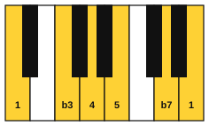
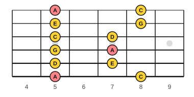

# The minor pentatonic scale

<span class="tag tag-guitar">Guitar</span>

After this lesson you can play box 1 of the A minor pentatonic scale at fret 5 on the guitar, name its five notes, and make up a short phrase with it over an Am chord.

Before this: [The natural minor scale](../05-minor-keys-and-chord-charts/01-natural-minor.md), [The A minor and D chords](../02-two-hands-and-first-chords/06-chords-a-minor-and-d.md), [Reading notation on guitar](../03-the-major-scale-and-keys/11-reading-notation-on-guitar.md), [Improvise in Dorian](05-improvise-in-dorian.md). You need: your guitar, a pick and a tuner.

## The idea

### Five notes

A **pentatonic scale** has five notes in an octave ("penta" is five). The **minor pentatonic** scale is the natural minor scale with two notes left out: the 2nd and the 6th. A natural minor has seven notes, 1 2 b3 4 5 b6 b7. Remove the 2 and the b6 and you have 1 b3 4 5 b7.

In A, the natural minor scale is A, B, C, D, E, F, G, A. Take out B and F:

the A minor pentatonic scale: A, C, D, E, G, A

Those are the notes you will play. The steps from A are A to C (3 half steps, a minor 3rd), C to D (2), D to E (2), E to G (3) and G to A (2). Two of the steps are bigger than a whole step, and none is a half step. With no half steps, no two neighbouring notes rub against each other, which is why the scale is a safe choice for a first improvisation.



### Box 1 at fret 5

On the guitar the scale is played as a **box**: a shape of two notes on each string, close together under the hand. Box 1 for A minor sits at frets 5 to 8. The index finger stays at fret 5 and the fourth finger reaches to fret 8.



| String | Frets | Notes | Fingers |
|---|---|---|---|
| 6 | 5, 8 | A, C | 1, 4 |
| 5 | 5, 7 | D, E | 1, 3 |
| 4 | 5, 7 | G, A | 1, 3 |
| 3 | 5, 7 | C, D | 1, 3 |
| 2 | 5, 8 | E, G | 1, 4 |
| 1 | 5, 8 | A, C | 1, 4 |

The salmon notes in the figure are A, the root of the scale. There are three of them in the box: string 6 at fret 5, string 4 at fret 7 and string 1 at fret 5. They are your places to come home.

The tab that the play bar shows under a staff may choose other frets for the same notes, because the same pitch often lives at more than one place on the neck. Use the fretboard figure for the position. In this lesson the hand stays at frets 5 to 8.

### Playing the box

Follow these steps.

1. Put your index finger across fret 5 on string 6 and play it with a down stroke. That is A.
2. Reach your fourth finger to fret 8 on the same string and play it. That is C.
3. Move to string 5. Play fret 5 with finger 1 and fret 7 with finger 3. Those are D and E.
4. Repeat on strings 4 and 3 (frets 5 and 7), then on strings 2 and 1 (frets 5 and 8).
5. Come back down in the reverse order.

Press close behind the fret wire and let each note ring. Use alternate picking, down and up strokes, so your picking hand keeps a steady motion.

Common mistake at step 3: pressing the wrong finger on fret 7. Finger 3 sits on fret 7, not finger 2. If the hand does not stay still at frets 5 to 8, slow down, and move your wrist rather than stretching your fingers.

## Hear and see

Example 1: box 1 up and down. These are eighth notes at 66 bpm, 12 notes up and 11 back. The staff is written an octave above the sound. The fretboard figure shows the position to use.

```abc
%%opts tab=guitar
X:1
M:4/4
L:1/8
Q:1/4=66
K:Am clef=treble-8
A, C D E G A c d | e g a c' a g e d | c A G E D C A,2 |]
```

Example 2: the backing loop. It is an Am chord strummed once in each of four bars. Loop it with the play bar while you play along.

```abc
%%opts tab=guitar
X:1
M:4/4
L:1/4
Q:1/4=66
K:Am clef=treble-8
"Am"[A, E A c e]4 | "Am"[A, E A c e]4 | "Am"[A, E A c e]4 | "Am"[A, E A c e]4 |]
```

### Your first try

Notes allowed: the 12 notes of box 1. Three rules:

1. Begin and end on an A.
2. Play two to four notes, then stop for a beat.
3. Play your idea twice, and change the last note the second time.

A wrong note here is a note outside the box, and you can fix it by moving back into the box. In this scale most notes sound fine, so you will hear that a phrase works, not that it is correct.

Example 3 is an improvisation over the loop in Example 2. Bars 1 and 3 repeat the same idea, and bars 2 and 4 answer with a different ending. It is four bars long.

```abc
%%opts tab=guitar
X:1
M:4/4
L:1/8
Q:1/4=66
K:Am clef=treble-8
"Am"A, C D2 C A,2 z | "Am"D E G2 E D2 z | "Am"A, C D2 C A,2 z | "Am"D E G2 A4 |]
```

## Try it

Exercise 1. Spell the A minor pentatonic scale, and say which two notes of the natural minor scale are left out.

<details class="solution" markdown>
<summary>Answer</summary>

The A minor pentatonic scale: A, C, D, E, G, A. The left-out notes are B (the 2nd) and F (the b6).

</details>

Exercise 2. On which strings and frets are the three A notes in box 1?

<details class="solution" markdown>
<summary>Answer</summary>

String 6 at fret 5, string 4 at fret 7, and string 1 at fret 5.

</details>

Exercise 3. Which finger plays each note on string 2 in box 1?

<details class="solution" markdown>
<summary>Answer</summary>

Finger 1 plays fret 5 (E) and finger 4 plays fret 8 (G).

</details>

<div class="practice" markdown>

### Practice routine (30 minutes)

| Minutes | What to do | Tempo | Listen for |
|---|---|---|---|
| 5 | Warm-up: box 1 up and down in eighth notes, down-up picking | 60 bpm | Even volume on every string |
| 15 | New skill: box 1 up and down, then improvise over the Am loop with the three rules, 5 minutes at a time, with a break to shake out your hand between | 66 bpm | Starting and ending on A, and rests between ideas |
| 5 | Ear: A minor pentatonic notes on piano, A C D E G, then humming along with the guitar | Untimed | The five notes, with no half steps |
| 5 | Piano: Lantern Rise from lesson 3, hands together | 66 bpm | The left hand softer than the right |

Repeat this routine on at least three days before you check the boxes below. If your fingers or wrist ache, stop and rest. If it keeps happening, see a teacher or a doctor.

</div>

<div class="move-on" markdown>

### Move on when

- [ ] You can play box 1 up and down at 66 bpm in eighth notes, three times in a row with no buzz and no stops.
- [ ] You can name the five notes of the A minor pentatonic scale and the three A positions in box 1 without looking.
- [ ] You can improvise 4 bars over the Am loop, starting and ending on A, with a rest after each idea.

</div>

## Common mistakes

Letting the hand drift. Your index finger should stay at fret 5 for the whole box. If it moves, slow down.

Stopping at a wrong note. If a note sounds odd, move to the next note in the box and keep the beat.

Playing without the loop. The scale is a set of notes. The loop makes it a sound, so play along with it.

## Key terms

- **Pentatonic scale**: a scale with five notes in an octave.
- **Minor pentatonic scale**: the notes 1, b3, 4, 5 and b7 of a minor scale.
- **Box**: a fretboard shape of two notes on each string, played under one position of the hand.

Next: [The five pentatonic boxes](09-pentatonic-boxes.md)
