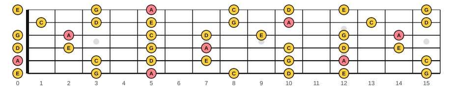
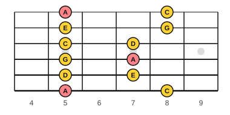
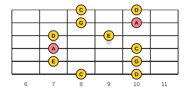
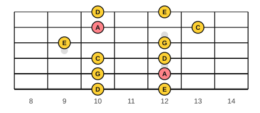
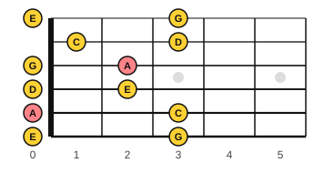
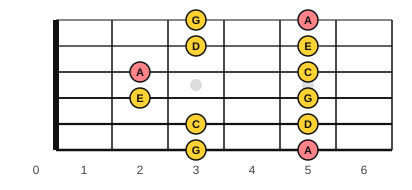

# The five pentatonic boxes

<span class="tag tag-guitar">Guitar</span>

After this lesson you can play all five boxes of the A minor pentatonic scale, move from one box to the next by sliding, and play a slide and a bend inside the boxes.

Before this: [The minor pentatonic scale](08-minor-pentatonic.md), [Slides and bends](../06-meter-terms-and-rhythm/12-slides-and-bends.md), [Power chords](../07-pedal-texture-and-ambient/07-power-chords.md). You need: your guitar, a pick and a tuner.

## The idea

### Five boxes cover the neck

Box 1 uses frets 5 to 8, and it holds two notes on each string. The same five notes of A minor pentatonic (A, C, D, E, G) appear on every string all the way up the neck, so there are other places to play them. The notes fall into five boxes, each a shape of two notes per string. Together the boxes cover the whole neck.

{ .mf-wide }

Each box shares one note on every string with the next box. The higher note of box 1 on a string is the lower note of box 2. That is how you move between boxes: on any string, slide from the top of one box to the top of the next, or pick a note that is in both.

### The boxes, one by one

Boxes 4 and 5 are drawn at the lowest frets on the neck, next to the nut, because the same shapes also appear 12 frets higher (boxes 4 and 5 at frets 12 to 17) where an acoustic guitar is harder to reach. The notes are the same an octave apart.

| Box | Frets | A notes in the box |
|---|---|---|
| 1 | 5 to 8 | string 6 fret 5, string 4 fret 7, string 1 fret 5 |
| 2 | 7 to 10 | string 4 fret 7, string 2 fret 10 |
| 3 | 9 to 13 | string 2 fret 10, string 5 fret 12 |
| 4 | 0 to 3 (or 12 to 15) | string 5 fret 0, string 3 fret 2 |
| 5 | 2 to 5 (or 14 to 17) | string 3 fret 2, string 6 fret 5, string 1 fret 5 |

Box 5 ends at fret 5, where box 1 begins. So the five boxes form a loop: 1, 2, 3, 4, 5, then back to 1 an octave higher.











Learn the boxes one at a time. For each one, find the A notes first, because they tell you where you are. Then play up the box and back, one string at a time, at 60 bpm. Use your first finger on the lowest fret of the box. The fingers of the box 1 shape apply to the others: finger 1 on the lowest fret, finger 3 or 4 on the highest.

### Connecting boxes by sliding

A **slide** moves one finger along a string from one fret to another without lifting, so the notes in between are heard. On a string, slide the finger from the top of one box to the top of the next. For example, on string 2, box 1 has G at fret 8, and box 2 has A at fret 10. Play G, slide the same finger up two frets, and you are in box 2.

Follow these steps for a slide.

1. Play the first note with a down stroke.
2. Keep the finger pressed and slide to the target fret in one smooth move.
3. Do not pick again. The target note rings from the slide.

Common mistake at step 2: lifting the finger partway. Keep it on the string, but press only lightly, and the string will not buzz as it slides.

### Bends

A **bend** pushes the string sideways with a fretting finger so the pitch rises. In this scale the usual bend raises a note a whole step to the next scale note, such as G (string 2 fret 8) bent up to A (the pitch of fret 10). Bends work best on strings 1 and 2.

The half step bend from the slides and bends lesson is a place to start. Bend only until the note sounds higher, then come back. Over a few weeks, work toward the whole step by matching the pitch to the fretted A at fret 10. Use finger 3 on the bending fret with fingers 1 and 2 pressing the same string behind it for support. Bending on a steel-string acoustic takes finger strength that builds slowly, so stop if the finger tips or the wrist hurt, and see a teacher or a doctor if it keeps happening.

The tab mark for a bend uses a b: 8b10 means play fret 8, then bend to the pitch of fret 10.

## Hear and see

Example 1 is the backing loop: an A5 power chord from stage 7, strummed on each beat for four bars. Use it with the play bar loop on.

```abc
%%opts tab=guitar
X:1
M:4/4
L:1/4
Q:1/4=66
K:Am clef=treble-8
"A5"[A, E A] [A, E A] [A, E A] [A, E A] | "A5"[A, E A] [A, E A] [A, E A] [A, E A] | "A5"[A, E A] [A, E A] [A, E A] [A, E A] | "A5"[A, E A] [A, E A] [A, E A] [A, E A] |]
```

Example 2: moving from box 1 into box 2. The run goes up box 1 and then continues into box 2 on the top three strings. Play fret 9 on string 3 for the e in bar 2, then frets 8 and 10 on string 2 and 1 for the notes that follow. The fretboard figures show the positions.

```abc
%%opts tab=guitar
X:1
M:4/4
L:1/8
Q:1/4=66
K:Am clef=treble-8
A, C D E G A c d | e g a c' d'4 |]
```

Example 3: a slide. Play the G on string 2 at fret 8, and slide the same finger up to fret 10 to reach A.

```abc
%%opts tab=guitar
X:1
M:4/4
L:1/8
Q:1/4=66
K:Am clef=treble-8
c2 e2 g2 "^slide"a2 | g2 e2 c4 |]
```

Example 4: a bend. The staff shows the note you reach. Play the G at fret 8 on string 2, then bend the string until it sounds like the A at fret 10.

```abc
%%opts tab=guitar
X:1
M:4/4
L:1/8
Q:1/4=66
K:Am clef=treble-8
c2 e2 "^8b10"a4 | g2 e2 c4 |]
```

The staff shows the pitch you hear. The tab under the staff may pick other frets, so follow the fretboard figures and the marks above the staff for where to play.

### Your first try across the boxes

Notes allowed: any note of A minor pentatonic in boxes 1 and 2 (frets 5 to 10). Three rules:

1. Begin and end on an A.
2. Start in box 1, and move to box 2 once by sliding.
3. Play a short idea, rest for a beat, and repeat it with a different last note.

## Try it

Exercise 1. Which two boxes share the note at string 4, fret 7?

<details class="solution" markdown>
<summary>Answer</summary>

Box 1 and box 2. Fret 7 is the top note of box 1 and the bottom note of box 2 on string 4.

</details>

Exercise 2. The A on string 2 appears in which box, and at which fret?

<details class="solution" markdown>
<summary>Answer</summary>

Fret 10, in box 2 and box 3.

</details>

Exercise 3. A slide from string 2 fret 8 to fret 10 moves between which boxes, and which note does it end on?

<details class="solution" markdown>
<summary>Answer</summary>

It moves from box 1 to box 2 and ends on A.

</details>

<div class="practice" markdown>

### Practice routine (30 minutes)

| Minutes | What to do | Tempo | Listen for |
|---|---|---|---|
| 5 | Warm-up: box 1 up and down in eighth notes | 66 bpm | Even picking, no buzz |
| 15 | New skill: learn one new box (2, then 3, then 4 and 5 on later days), find the A notes, play it up and down, then connect it to the box before by a slide, then improvise over Example 1 with the three rules | 60 bpm, then 66 | Landing on A at the end of each phrase |
| 5 | Ear: play the A minor pentatonic notes on piano and name them as you go | Untimed | The five notes, with no half steps |
| 5 | Piano: Lantern Rise or an improvisation in D Dorian | 66 bpm | A steady left hand |

Repeat this routine on at least five days, adding one new box about every second day. If your fingers or wrist ache, stop and rest.

</div>

<div class="move-on" markdown>

### Move on when

- [ ] You can play boxes 1, 2 and 3 up and down at 66 bpm in eighth notes, three times in a row with no buzz.
- [ ] You can name the frets of all five boxes and the string and fret of the A notes in box 1 without looking.
- [ ] You can slide from box 1 to box 2 on strings 2 and 1 and land on the A.
- [ ] You can play a half step bend on string 1 or 2 and hear the pitch rise.

</div>

## Common mistakes

Learning the shapes without the root. Find the A notes first, or you will not know where home is.

Bending too fast. Take the bend slowly and aim for a pitch you can hear against the fretted note.

Gripping too hard on slides. Press lightly while the finger is moving, and press firmly when it lands.

## Key terms

- **Slide**: moving one finger along a string from one fret to another without lifting it.
- **Bend**: pushing a string sideways with a fretting finger so the pitch rises.

Next: [Improvise over film progressions](10-improvise-over-film-progressions.md)
