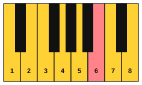
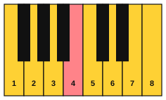
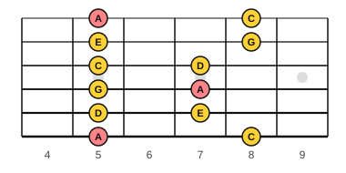
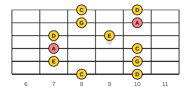
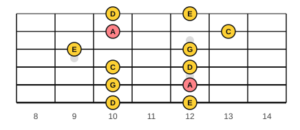
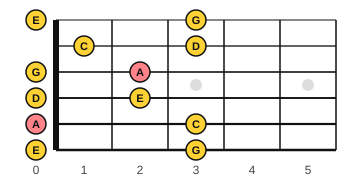
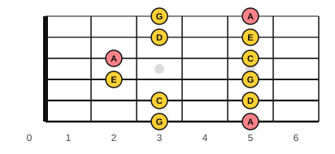

# Stage 12: Modes and improvising

This stage teaches you to make up music in small, safe steps. You learn the seven modes and the moods they give, how to hear the characteristic note of each, and the left-hand patterns that give an improvisation a floor. On piano you improvise in D Dorian, F Lydian and a quiet ambient style. On guitar you learn the minor pentatonic scale and its five boxes, then use it over film-style chord loops. The last two lessons cover call and response and variations on a theme. Wrong notes are part of improvising, so each lesson gives you a few notes, a backing loop and three rules. It usually takes about 8 to 10 weeks at 30 minutes a day.

<!-- lessons:start -->
## Lessons

1. [The modes](01-modes.md) (theory)
2. [Hearing the modes](02-hearing-modes.md) (ear)
3. [Lydian and the sound of wonder](03-lydian-wonder.md) (piano)
4. [Left-hand patterns for improvising](04-left-hand-patterns-for-improvising.md) (piano)
5. [Improvise in Dorian](05-improvise-in-dorian.md) (improvise)
6. [Improvise in Lydian](06-improvise-in-lydian.md) (improvise)
7. [Ambient improvising](07-ambient-improvising.md) (improvise)
8. [The minor pentatonic scale](08-minor-pentatonic.md) (guitar)
9. [The five pentatonic boxes](09-pentatonic-boxes.md) (guitar)
10. [Improvise over film progressions](10-improvise-over-film-progressions.md) (improvise)
11. [Call and response](11-call-and-response.md) (improvise)
12. [Variations on a theme](12-variations-on-a-theme.md) (improvise)

<!-- lessons:end -->

Download the stage 12 deck: [12-modes-and-improvising.apkg](../downloads/anki/12-modes-and-improvising.apkg)

## Cheat sheet

Everything to remember from this stage, on one page.

### The seven modes

| Mode | White keys | Formula | Characteristic note | Mood |
|---|---|---|---|---|
| Ionian | C to C | 1 2 3 4 5 6 7 | none (major) | bright, settled |
| Dorian | D to D | 1 2 b3 4 5 6 b7 | natural 6 (B) | minor but hopeful |
| Phrygian | E to E | 1 b2 b3 4 5 b6 b7 | b2 (F) | dark, tense |
| Lydian | F to F | 1 2 3 #4 5 6 7 | #4 (B) | floating, wonder |
| Mixolydian | G to G | 1 2 3 4 5 6 b7 | b7 (F) | relaxed, heroic |
| Aeolian | A to A | 1 2 b3 4 5 b6 b7 | b6 (F) | sad, epic |
| Locrian | B to B | 1 b2 b3 4 b5 b6 b7 | b5 (F) | unstable |

From brightest to darkest: Lydian, Ionian, Mixolydian, Dorian, Aeolian, Phrygian, Locrian. A mode needs a home note: hold a drone to hear it.

### Hearing a mode

1. Find home (the drone).
2. Is the 3rd major (Ionian, Lydian, Mixolydian) or minor (Dorian, Phrygian, Aeolian)?
3. Listen for the altered note: #4 is Lydian, b7 is Mixolydian, natural 6 is Dorian, b2 is Phrygian, b6 is Aeolian.

### The minor pentatonic scale

The A minor pentatonic scale: A, C, D, E, G (1 b3 4 5 b7). Box 1 is at frets 5 to 8.

| String | Box 1 frets | Notes | Fingers |
|---|---|---|---|
| 6 | 5, 8 | A, C | 1, 4 |
| 5 | 5, 7 | D, E | 1, 3 |
| 4 | 5, 7 | G, A | 1, 3 |
| 3 | 5, 7 | C, D | 1, 3 |
| 2 | 5, 8 | E, G | 1, 4 |
| 1 | 5, 8 | A, C | 1, 4 |

| Box | Frets |
|---|---|
| 1 | 5 to 8 |
| 2 | 7 to 10 |
| 3 | 9 to 13 |
| 4 | 0 to 3 (or 12 to 15) |
| 5 | 2 to 5 (or 14 to 17) |

Each box shares one note on every string with the next. Slide from the top of one box to the top of the next to connect them.

### Left-hand patterns (on D)

| Pattern | Notes | Fingers |
|---|---|---|
| Drone | D2 held | 5 |
| Open fifth | D2 and A2 together | 5, 1 |
| Broken fifth | D2, A2, D3, A2 | 5, 2, 1, 2 |
| Vamp | two bars D (D2 A2 D3 A2), one bar G (G2 D3 G3 D3), one bar D | 5, 2, 1, 2 |

### Rules for a first improvisation

1. Use only the notes allowed (a scale or a few notes), and begin and end on home.
2. Play a short idea, then rest. Do not fill every beat.
3. Say the idea twice and change the ending the second time.

A wrong note is information. Keep the beat, move a step, and use it as a motif if you like it. On a chord change, land on a note of the new chord. In call and response, the call ends away from home and the answer ends on home.
