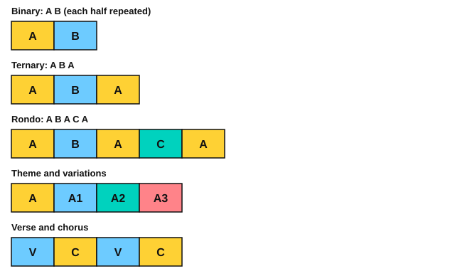

# Phrases and form

<span class="tag tag-theory">Theory</span>

After this lesson you can hear and name phrases and periods, and label a piece as binary, ternary, rondo, theme and variations, or verse and chorus.

Before this: [Cadences](../09-harmony/03-cadences.md), [Transposition](01-transposition.md), [Minuet in G](../03-the-major-scale-and-keys/10-minuet-in-g.md), [Articulation and repeat signs](../06-meter-terms-and-rhythm/04-articulation-and-repeat-signs.md). You need: your piano.

## The idea

### Phrases and periods

A **phrase** is a musical sentence: a stretch of music that feels like it has one breath and ends at a resting point. In the minuet lesson you met two-bar and four-bar phrases. Play this tune from the first phrase of Ode to Joy and listen to where each phrase stops.

```abc
X:1
M:4/4
L:1/4
Q:1/4=80
K:C
E E F G | G F E D | C C D E | E3/2 D/ D2 |
E E F G | G F E D | C C D E | D3/2 C/ C2 |]
```

The first four bars end on D, which sounds unfinished. The second four bars start the same way and end on C, the tonic, which sounds finished. Two phrases that pair up like this are a **period**: the first is the antecedent (the question) and the second is the consequent (the answer). The unfinished ending is usually a half cadence and the finished one a perfect cadence, as in the lesson on cadences.

### Binary and ternary

Form is the plan of a piece: how its sections are ordered. Letters name the sections, and a repeated letter means the music returns.

**Binary form** has two sections, A and B, and usually each is repeated. Many dances work this way. Two pieces in this stage, the Carcassi study (lesson 9) and the Bach bourrée (lesson 10), are binary: each half is played twice.

**Ternary form** has three sections, A B A. The B section contrasts, and then the first section returns. Schumann's Träumerei (lesson 5) has three parts of 8 bars, and its third part brings back the opening bars of the first.

### Rondo and theme and variations

A **rondo** brings the main theme back several times between contrasting sections: A B A C A. Beethoven's Für Elise is a rondo. Count the returns of the opening tune.

**Theme and variations** states a theme and then plays it again with changes: A, A1, A2, A3. The change can be rhythm, register (high or low), mode, ornament or harmony. Mozart wrote variations on the French tune Ah vous dirai-je, Maman, the tune Twinkle Twinkle Little Star uses. Stage 12 has a lesson on [varying a theme](../12-modes-and-improvising/12-variations-on-a-theme.md).



### Verse and chorus

Film, game and song music often uses **verse and chorus** form. The verse carries the changing part, at lower energy, and the chorus is the main hook that returns unchanged. Game and film cues also loop one short section many times, so you will often hear an 8-bar or 16-bar block repeat. The chord loops of stage 11 ([Aeolian loops](../11-film-game-and-anime-harmony/04-aeolian-loops.md)) are such blocks.

### How to find the form of a piece

1. Listen once without the score and hum where the music seems to stop.
2. Mark every cadence on the score.
3. Give a letter to each stretch, and give it the same letter when the music returns.
4. Write the bar numbers next to each letter. The piece lessons that follow do this for you.

## Try it

Exercise 1. A piece has the sections 1 to 8, 9 to 16, then 1 to 8 again. Name the form.

<details class="solution" markdown>
<summary>Answer</summary>

Ternary, A B A.

</details>

Exercise 2. In the Ode to Joy phrase above, which note ends the antecedent and which ends the consequent?

<details class="solution" markdown>
<summary>Answer</summary>

D ends the antecedent (bar 4) and C ends the consequent (bar 8).

</details>

Exercise 3. A song goes verse, chorus, verse, chorus. Draw it as letters.

<details class="solution" markdown>
<summary>Answer</summary>

V C V C.

</details>

<div class="practice" markdown>

### Practice routine (30 minutes)

| Minutes | What to do | Tempo | Listen for |
|---|---|---|---|
| 5 | Warm-up: C and G major scales, two octaves, hands together | 72 bpm | Even notes |
| 15 | Play the Ode to Joy period on piano and on guitar (strings 2 and 1), then play the antecedent twice with the second ending on C | 70 bpm | The first ending sounds unfinished |
| 5 | Pick a piece from stages 3 to 8 and label its form with letters and bar numbers | Untimed | Where the music returns |
| 5 | Guitar: any chord progression from stage 5, four strums per bar | 70 bpm | Even strums |

Repeat this routine on at least three days.

</div>

<div class="move-on" markdown>

### Move on when

- [ ] You can play the Ode to Joy period and say why the first half sounds unfinished.
- [ ] You can draw binary, ternary and rondo form as letters from memory.
- [ ] You can label the form of two pieces you have played, with bar numbers.

</div>

## Common mistakes

Calling every repeat sign binary form. A piece with one section played twice is still one section.

Giving a new letter to a small change. If the tune returns with a different last bar, call it A again, and say what changed.

## Key terms

- **Phrase**: a musical sentence that ends at a resting point.
- **Period**: two phrases, a question (antecedent) and an answer (consequent).
- **Binary form**: two sections, A B, usually each repeated.
- **Ternary form**: three sections, A B A.
- **Rondo**: the main theme returns between contrasting sections, A B A C A.
- **Theme and variations**: a theme followed by changed versions of it.
- **Verse and chorus**: a changing verse and a returning hook.

Next: [The alto and tenor clefs](03-alto-and-tenor-clefs.md)
