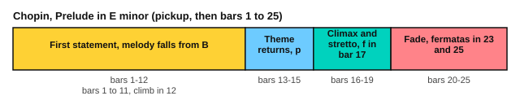

# Chopin: Prelude in E minor

<span class="tag tag-piano">Piano</span> <span class="tag tag-stretch">Stretch piece</span>

After this lesson you can play Chopin's Prelude in E minor, Op. 28 No. 4, or a slow, careful version of it, with a quiet repeated chord in the left hand and a falling melody in the right.

Before this: [Legato pedalling](../07-pedal-texture-and-ambient/02-legato-pedalling.md), [Voicing the melody](../07-pedal-texture-and-ambient/09-voicing-the-melody.md), [Harmonic and melodic minor](../05-minor-keys-and-chord-charts/02-harmonic-and-melodic-minor.md), [Phrases and form](02-phrases-and-form.md). You need: your piano with its damper pedal, and a metronome.

This is a stretch piece. It sits above the book's main target (roughly RCM 7 to 8). It has few notes and no fast passages, but it needs steady quiet chords and careful pedalling for many bars at once. If it feels too far, skip it and come back after you have finished the other lessons in this stage.

## The idea

### The piece

Frédéric Chopin wrote 24 preludes as his Opus 28. This is No. 4. It is in E minor, which has one sharp (F#), and in 2/2, the time signature with two half-note beats in a bar. The score is marked Largo, which means very slow. The play bar below uses 56 for a quarter note, and you will start far slower. The piece starts with a one-beat pickup, then has 25 bars.

The texture is simple to describe. The left hand plays the same chord eight times in every bar, in eighth notes, and changes one note of the chord at a time. The right hand has a slow melody that mostly falls by step. The left hand is quiet and even; the right hand sings above it.

```abc
X:1
T:Prelude in E minor, Op. 28 No. 4
C:Frederic Chopin (1810-1849)
M:2/2
L:1/16
Q:1/4=56
K:Em
%%score {RH LH}
V:RH clef=treble
V:LH clef=bass
V:RH
"^Largo"!p!(B,3"_espressivo"B | B12 c4 | B12 c4 | B12 c4 |
V:LH
z4 | ([G,B,E]2[G,B,E]2 [G,B,E]2[G,B,E]2 [G,B,E]2[G,B,E]2 [G,B,E]2[G,B,E]2 | [F,A,E]2[F,A,E]2 [F,A,E]2[F,A,E]2 [F,A,^D]2[F,A,D]2 [F,A,D]2[F,A,D]2 | [=F,A,^D]2[F,A,D]2 [F,A,D]2[F,A,D]2 [F,A,=D]2[F,A,D]2 [F,^G,D]2[F,G,D]2 |
V:RH
B12 _B4 | A12 B4 | A12 B4 | A12 B3A |
V:LH
[E,^G,D]2[E,G,D]2 [E,G,D]2[E,G,D]2 [E,=G,D]2[E,G,D]2 [E,G,^C]2[E,G,C]2 | [E,G,C]2[E,G,C]2 [E,G,C]2[E,G,C]2 [E,F,C]2[E,F,C]2 [E,F,C]2[E,F,C]2 | [E,F,C]2[E,F,C]2 [E,F,C]2[E,F,C]2 [^D,F,C]2[D,F,C]2 [D,F,C]2[D,F,C]2 | [D,F,C]2[D,F,C]2 [D,F,C]2[D,F,C]2 [D,F,C]2[D,F,C]2 [D,F,C]2[D,F,C]2 |
V:RH
A12) (^G4- | ^G4 A2B2 d2c2 E2A2 | F12) (A4 | F12) (A4 |
V:LH
[D,=F,C]2[D,F,C]2 [D,F,C]2[D,F,C]2 [D,F,B,]2[D,F,B,]2 [D,F,B,]2[D,F,B,]2 | [C,E,B,]2[C,E,B,]2 [C,E,A,]2[C,E,A,]2 [C,E,A,]2[C,E,A,]2 [C,E,A,]2[C,E,A,]2 | [B,,E,A,]2[B,,E,A,]2 [B,,^D,A,]2[B,,D,A,]2 [C,E,A,]2[C,E,A,]2 [C,E,A,]2[C,E,A,]2 | [B,,^D,A,]2[B,,D,A,]2 [B,,D,A,]2[B,,D,A,]2 [C,E,A,]2[C,E,A,]2 [C,E,A,]2[C,E,A,]2 |
V:RH
G2F2 !crescendo(!!accent!C2B,2 ^D2!crescendo)!F2 (3!diminuendo(!d2c2B2!diminuendo)! | !p!(B12) c4 | B12 c4 | B12 c4 |
V:LH
[B,,^D,A,]4) z12 | ([G,B,E]2[G,B,E]2 [G,B,E]2[G,B,E]2 [G,B,E]2[G,B,E]2 [G,B,E]2[G,B,E]2 | [F,A,E]2[F,A,E]2 [F,A,E]2[F,A,E]2 [=F,A,^D]2[F,A,D]2 [F,A,D]2[F,A,D]2 | [=F,^G,^D]2[F,G,D]2 [F,G,=D]2[F,G,D]2 [E,G,D]2[E,G,D]2 [E,G,D]2[E,G,D]2 |
V:RH
!crescendo(!B3^A "^stretto"A4 !crescendo)!!turn!!diminuendo(!^^g4 f3!diminuendo)!e | !f!!crescendo(!e2^d2 c'2!crescendo)!d2 !diminuendo(!d2e2 g2B2 | d2c2 (3e2E2A2!diminuendo)! "_dim."F6 A2 | !p!F12) (A4 |
V:LH
[E,G,D]2[E,G,D]2 [E,G,^C]2[E,G,C]2 [^C,E,^A,]2[C,E,A,]2 [=C,E,=A,]2[C,E,A,]2 | [B,,,B,,]2)([A,CFA]2 [A,CFA]2[A,CFA]2 [G,B,^DF]2[G,B,E]2 [G,B,E]2[G,B,E]2 | [A,CE]2[A,CE]2 A,,2[E,F,C]2 [B,,E,B,]2[B,,E,B,]2 [C,E,A,]2[C,E,A,]2 | [B,,E,B,]2[B,,E,B,]2 [B,,E,B,]2[B,,E,B,]2 [C,E,A,]2[C,E,A,]2 [C,E,A,]2[C,E,A,]2 |
V:RH
F12- F3E | "_smorz."!diminuendo(!E12 F4 | !diminuendo)!E12 F4 | E8) !fermata!z8 |
V:LH
[B,,E,B,]2[B,,E,B,]2 [B,,E,B,]2[B,,E,B,]2 [B,,^D,B,]2[B,,D,B,]2 [B,,D,A,]2[B,,D,A,]2 | [C,G,]2[C,G,]2 [C,G,]2[C,G,]2 [C,_B,]2[C,B,]2 [C,E,A,]2[C,E,A,]2 | [B,,E,A,]2[B,,E,A,]2 [B,,E,^G,]2[B,,E,G,]2 [B,,E,=G,]2[B,,E,G,]2 [B,,E,G,]2[B,,E,G,]2 | [_B,,C,G,]8) z8 |
V:RH
!pp!(E8 ^D8 | !fermata!E16) |]
V:LH
[B,,,B,,E,F,B,]8 [B,,,F,,B,,^D,F,B,]8 | [E,,,E,,E,G,B,]16 |]
```

Source: Mutopia Project Mutopia-2016/10/28-468 (maintainer Magnus Lewis-Smith), Public Domain, from the Peters 1879 edition.

### Form by bar number



| Bars | What happens |
|---|---|
| Pickup, 1 to 3 | The right hand holds B and moves up to C at the end of each bar, over an E minor chord |
| 4 to 11 | The melody falls: B and Bb in bar 4, A in bars 5 to 8, then G#, a short figure in bar 9, and F in bars 10 and 11 |
| 12 | A climb in the right hand with a triplet at the end; the left hand plays one chord and rests |
| 13 to 15 | The opening comes back, marked p |
| 16 to 19 | The climax. Bar 16 is marked stretto (pressing on) and has G double sharp (G##, the same key as A) with a turn. Bar 17 is marked f, bar 18 has a triplet, and bar 19 is marked p, the start of the fall |
| 20 to 22 | The melody keeps falling and the sound fades, marked smorz. (dying away) in bar 21 |
| 23 to 25 | A fermata (a pause) on the rest in bar 23, then pp in bar 24, and a final chord with a fermata in bar 25 |

The page's score leaves out the small grace notes in bars 11 and 19 and the pedal marks of the printed edition. Look at a printed edition when you have it, and compare.

## Hard spots

| Bars | Why they are hard | What to do |
|---|---|---|
| 1 to 11 | Eight chords in every bar at the same soft volume | Drop the arm weight into each chord and let the wrist stay loose. Play the chords alone at 60 for the eighth note and listen for any chord that sticks out |
| 9 | Several quick notes with leaps in the right hand | Play bar 9 alone, hands separately, at half speed |
| 12 and 18 | A triplet in the melody | Say "trip-let" aloud over steady chords in the left hand, then add the right hand |
| 16 to 18 | The loudest bars, with wide left-hand chords | Learn the left hand alone. Keep the right hand singing, and crescendo only as far as f |
| 23 to 25 | Fermatas and the very quiet ending | Count the rest in bar 23, hold the last chord, and let it die before you lift the pedal |

Left-hand fingering for a root-position chord of three notes is 5, 3, 1 (for example E3, G3 and B3). Choose the nearest fingers for each change, and write your choices on your copy.

Here is a short exercise in the same style, written for this lesson. The left hand repeats a chord and changes its top note halfway through bar 2.

```abc
X:1
M:2/2
L:1/8
Q:1/4=56
K:Em
%%score {RH LH}
V:RH clef=treble
V:LH clef=bass
V:RH
!p!B8 | B4 A4 |]
V:LH
[E,G,B,][E,G,B,][E,G,B,][E,G,B,] [E,G,B,][E,G,B,][E,G,B,][E,G,B,] | [E,G,B,][E,G,B,][E,G,B,][E,G,B,] [D,F,A,][D,F,A,][D,F,A,][D,F,A,] |]
```

### Pedalling

Use the damper pedal as in the legato pedalling lesson.

1. Press the pedal right after the first chord of a bar sounds.
2. Lift and press again when a chord changes, such as halfway through bar 2.
3. Lift at the end of bar 12 where the left hand stops, so the climb is clear.
4. If the sound blurs, change the pedal more often.

The score's printed pedal marks are not on this page, so this is a suggestion. Listen for blur and decide with your ears.

### Plan for six weeks

| Week | Bars | Aim |
|---|---|---|
| 1 | Pickup to 3 | Left-hand chords alone at 60 for the eighth note, then the right hand |
| 2 | 4 to 11 | Left hand alone, then right hand, then together at 50 for the quarter |
| 3 | 12 to 15 | The climb in bar 12, then the return |
| 4 | 16 to 19 | The climax, left hand first |
| 5 | 20 to 25 | The fade and the ending, then join every section |
| 6 | All | Whole piece at 50 and then 56, with pedal; record it |

## Try it

Exercise 1. How many eighth-note chords does the left hand play in a full bar of 2/2 in this piece?

<details class="solution" markdown>
<summary>Answer</summary>

Eight. A bar of 2/2 has four quarter notes, and each quarter note has two eighth notes.

</details>

Exercise 2. Which bars are the return of the opening?

<details class="solution" markdown>
<summary>Answer</summary>

Bars 13 to 15, marked p.

</details>

Exercise 3. Which bar has the fermata on a rest?

<details class="solution" markdown>
<summary>Answer</summary>

Bar 23.

</details>

<div class="practice" markdown>

### Practice routine (30 minutes)

| Minutes | What to do | Tempo | Listen for |
|---|---|---|---|
| 5 | Warm-up: E minor scale (natural and harmonic) two octaves, hands separately | 66 bpm | Even notes |
| 15 | The section of the week: left hand alone, right hand alone, then together | 50 bpm for the quarter note | No chord louder than the rest |
| 5 | Sight reading: a slow piece from the practice tools | 50 bpm | Keep going after a wrong note |
| 5 | Guitar: Em, Am and D chord changes, one chord per bar | 60 bpm | Every string rings |

Repeat this routine on most days. Each week, move the 15 minutes to the next section of the plan.

</div>

<div class="move-on" markdown>

### Move on when

- [ ] You can play bars 1 to 11 hands together at 50 for the quarter note, three times in a row with no stops.
- [ ] You can play the whole piece at 50 with the pedal, with no stops.
- [ ] You can record yourself and find no left-hand chord that is louder than its neighbours.
- [ ] You can name the key, the time signature and the bar numbers of the sections without looking.

</div>

## Common mistakes

Playing the left-hand chords louder when the right-hand melody rises. Keep the chords at the same soft level and let the melody stand above them.

Rushing the triplets in bars 12 and 18. Count them against steady eighths.

Holding the pedal through chord changes. The harmony changes note by note, so change the pedal when a chord changes.

## Key terms

- **Prelude**: a short piece for piano with no set form.
- **Largo**: a very slow tempo.
- **Stretto**: pressing on, a little faster.
- **Smorzando**: dying away.
- **Fermata**: a pause on a note or rest, longer than its written length.

Next: [Schumann: Träumerei](05-schumann-traumerei.md)
