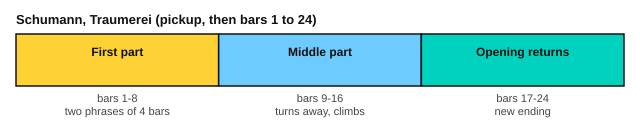

# Schumann: Träumerei

<span class="tag tag-piano">Piano</span> <span class="tag tag-stretch">Stretch piece</span>

After this lesson you can play, or work towards, Schumann's Träumerei, Op. 15 No. 7, keeping a singing melody on top of four moving parts.

Before this: [Voicing the melody](../07-pedal-texture-and-ambient/09-voicing-the-melody.md), [Legato pedalling](../07-pedal-texture-and-ambient/02-legato-pedalling.md), [Half pedal, una corda and sostenuto](../07-pedal-texture-and-ambient/03-half-pedal-una-corda-and-sostenuto.md), [Phrases and form](02-phrases-and-form.md), [Schumann: Melody and Soldiers' March](../05-minor-keys-and-chord-charts/09-schumann-album-for-the-young.md). You need: your piano with its damper pedal, and a metronome.

This is a stretch piece, above the book's main target (roughly RCM 7 to 8). It is slow, but the left hand and the right hand each play two parts at once, and the stretch of the hand is wide. You can come back to it later; nothing after it in the book depends on it.

## The idea

### The piece

Träumerei (German for "dreaming") is the seventh piece of Robert Schumann's Scenes from Childhood, Op. 15, from 1838. It is in F major, which has one flat (Bb), and in 4/4. Schumann marked it Nicht schnell, "not fast". The play bar uses 56 for a quarter note. It starts with a one-beat pickup (the note C) and has 24 bars.

The score has four parts: a melody on top, two inner parts, and a bass, so each hand often plays two notes at once. The converted score below writes each part on its own line, so it looks crowded.

```abc
X:1
T:Traumerei (Kinderszenen, Op. 15 No. 7)
C:Robert Schumann (1810-1856)
M:4/4
L:1/16
Q:1/4=56
K:F
%%score {(RH RH2 RH3 RH4) (LH LH2 LH3 LH4)}
V:RH clef=treble
V:RH2 clef=treble
V:RH3 clef=treble
V:RH4 clef=treble
V:LH clef=bass
V:LH2 clef=bass
V:LH3 clef=bass
V:LH4 clef=bass
V:RH
!p!C4 | F8- F2E2 F2A2 | c2f2 f8 e2d2 | c2f2 G2A2 B2d2 F2[EG]2 |
V:RH2
x4 | x4 [F,C]12 | x4 F12- | F4 E8 C4- |
V:RH3
x4 | x16 | x16 | x16 |
V:RH4
x4 | x16 | x16 | x16 |
V:LH
z4 | F,,16- | F,,4 D8 C2B,2 | [C,A,]4 B,2A,2 G,4 [A,,F,]2[C,G,]2 |
V:LH2
x4 | x4 [C,A,]12- | [C,A,]4 x12 | x4 C,8 x4 |
V:LH3
x4 | x16 | x3x/ F,12- F,/- | F,/ x12 x3x/ |
V:LH4
x4 | x16 | x3x/B,, x8 x3x/ | x16 |
V:RH
[FA]2c2 [CEG]8 C4 | F8- F2E2 F2A2 | c2a2 a6 g2 f2e2 | f2a2 d2[_Af]2 e6 [^F_e]2 |
V:RH2
C4 x12 | x4 [F,C]12 | x4 A12- | A6 x2 G2c2 E2x2 |
V:RH3
x16 | x16 | x4 G12 | x16 |
V:RH4
x16 | x16 | x16 | x16 |
V:LH
[F,A,]4 G,8 G,,2A,,2 | F,,16- | F,,4 E12 | [D,D]6 C8 [A,C]2 |
V:LH2
x4 C,2D,2 C,2B,,2 x4 | x4 A,12- | A,16- | A,6- A,/x3/2 G,6 x2 |
V:LH3
x16 | x4 C,12- | C,4 x12 | x6 F,2 x8 |
V:LH4
x16 | x16 | x3x/^C, x8 x3x/ | x16 |
V:RH
d4 e4 z6 C2 | "^ritard."F8- F2E2 F2A2 | "^(a tempo)"c2[B_e]2 [Ae]8 d2c2 | B2d2 z2[_EA]2 B6 [CA]2 |
V:RH2
F8 x8 | x4 [F,C]12 | x8 x2^F2 A4 | G6 x2 D2G2 B,2x2 |
V:RH3
x6 x3/2 c4- c/ x4 | x16 | x16 | x16 |
V:RH4
x8 E4 x4 | x16 | x16 | x16 |
V:LH
=B,2G2 A,2B,2 [C,C]2D,2 B,,2G,,2 | F,,16 | z2[C,G,]2 ^F,2A,2 D8- | D6 [C,^F,]2 [D,G,]6 _E,2 |
V:LH2
G,8 x8 | x4 [C,A,]12 | x4 D,8- D,2^F,2 | G,6 x8 x2 |
V:LH3
x16 | x16 | x16 | x16 |
V:LH4
x16 | x16 | x16 | x16 |
V:RH
G6 D6 z2F2 | B8- B2A2 B2d2 | f4 [eb]8 a2g2 | f2a2 z2[Be]2 f6 [Ge]2 |
V:RH2
x6 C2 B,4 x4 | x4 [B,F]12 | x2b2 x6 ^c2 e4 | d6 x2 A2d2 F2x2 |
V:RH3
x16 | x16 | x16 | x16 |
V:RH4
x16 | x16 | x16 | x16 |
V:LH
B,2D2 G,2 [D,A,]4 G,2 G,,2A,,2 | B,,,4 [F,D]12 | z2[G,D]2 ^C2E2 A8- | A6 [G,^C]2 [A,D]6 B,2 |
V:LH2
D,6 x8 x2 | x16 | x4 A,8- A,2^C2 | D6 x8 x2 |
V:LH3
x16 | x16 | x16 | x16 |
V:LH4
x16 | x16 | x16 | x16 |
V:RH
d6 A6 [EG]4 | F8- F2E2 F2A2 | "^(a tempo)"c2f2 f8 e2d2 | c2f2 G2A2 B2d2 F2[EG]2 |
V:RH2
F2A2 x2G2 F4 x3x/C/- | C3/2x2x/ [F,C]12 | x4 F12- | F4 E8 C4- |
V:RH3
x16 | x16 | x16 | x16 |
V:RH4
x16 | x16 | x16 | x16 |
V:LH
A,8- A,2z2 C2C,2 | F,,16- | F,,4 D8 C2B,2 | [C,A,]4 B,2A,2 G,4 [A,,F,]2[C,G,]2 |
V:LH2
x4 D2[^CE]2 D4 x4 | x4 [C,A,]12- | [C,A,]4 x12 | x4 C,8 x4 |
V:LH3
x8 x2 B,4 x2 | x16 | x3x/ F,12- F,/- | F,/ x12 x3x/ |
V:LH4
x16 | x16 | x3x/B,, x8 x3x/ | x16 |
V:RH
[FA]2c2 [CEG]8 C4 | F8- F2E2 F2A2 | c2a2 a6 g2 f2z2 | c2f2 G2A2 B2d2 G2[^FA]2 |
V:RH2
C4 x12 | x4 [F,C]12 | x4 [Gd]12 | x4 E8 D4- |
V:RH3
x16 | x16 | x4 F12- | F4 x12 |
V:RH4
x16 | x16 | x16 | x16 |
V:LH
[F,A,]4 G,8 G,,2A,,2 | F,,16- | F,,4 [G,,=B,,=B,]12 | [C,A,C]4 B,2A,2 G,4 [B,,G,]2[D,A,]2 |
V:LH2
x4 C,2D,2 C,2B,,2 x4 | x4 [C,A,]12- | [C,A,]4 x12 | x4 C,8 x4 |
V:LH3
x16 | x16 | x16 | x16 |
V:LH4
x16 | x16 | x16 | x16 |
V:RH
[GB]2d2 D2E2 [A,F]8 |]
V:RH2
D4 B,4 x8 |]
V:RH3
x6 C8- C2 |]
V:RH4
x16 |]
V:LH
[G,B,]4 G,4 z8 |]
V:LH2
x4 C,12 |]
V:LH3
x6 C,,2 F,,8 |]
V:LH4
x16 |]
```

Source: Mutopia Project Mutopia-2005/12/27-504 (maintainer Ying-Chun Liu), Public Domain, from the Leichte Stuecke edition, 1900.

### Form by bar number



| Bars | What happens |
|---|---|
| 1 to 4 | First phrase: F held, then E, F, A leading up to a high F; ends on a C chord in bar 4 |
| 5 to 8 | Second phrase. It starts like bar 1 and goes higher, to A. Bar 7 has Ab, F# and Eb, notes outside F major |
| 9 to 16 | Middle part. Bar 9 is marked ritard., and bar 10 is marked a tempo. The music turns away from F with Eb in bars 10 and 11, and climbs to the highest notes of the piece in bar 14 |
| 17 to 24 | The opening returns. Bars 17 to 19 are the same as bars 1 to 3, and bar 18 is marked a tempo. The ending differs from bars 6 and 7, and the piece ends on an F chord in bar 24 |

The same four notes, F, E, F, A, start bars 1, 5, 9, 17 and 21. Hearing that figure come back is the easiest way to keep your place.

## Hard spots

| Bars | Why they are hard | What to do |
|---|---|---|
| 1 to 4 | Melody with moving inner notes | Play the top line alone and sing it. Then add the lowest line. Add the inner notes last |
| 4 and 20 | Three-note chords in the right hand | Play the chord as a block and make the top note the loudest |
| 7 | Notes outside the key: Ab, F# and Eb | Read the accidentals aloud before you play, and learn the bar hands separately |
| 9 to 11 | Ritard. then a tempo, with Eb | Count the slowing down, and keep the beat when you return to a tempo |
| 13 to 15 | Right-hand leaps and the highest notes | Practise the leaps alone, without looking at your hand |
| 22 to 24 | Different ending to the return | Mark the differences from bars 6 to 8 in pencil |

For fingering, aim for a melody that sounds joined. When a note is held (the F in bar 1), keep the finger on it and play the inner notes with other fingers. Use finger changes on a held key, and write your fingering above the notes. Pedalling makes up the rest of the join.

Here is a short exercise in the same texture, written for this lesson: a melody, an inner voice and a bass.

```abc
X:1
M:4/4
L:1/4
Q:1/4=56
K:F
%%score {(RH RH2) LH}
V:RH clef=treble
V:RH2 clef=treble
V:LH clef=bass
V:RH
!p!c2 f2 | e d c2 |]
V:RH2
F2 A2 | G2 F2 |]
V:LH
F,,4 | C,2 F,2 |]
```

### Pedalling

The page's score has no pedal marks. Use the damper pedal as a suggestion.

1. Change the pedal on each new bass note.
2. Also change it whenever the melody moves to a note that clashes with the old sound, such as the Eb and Ab in the middle part.
3. Make the change quickly: lift, then press again right away, listening for a clear melody note.
4. If your piano supports half pedalling, try a shallow pedal in the quiet bars.

### Plan for six weeks

| Week | Bars | Aim |
|---|---|---|
| 1 | Pickup to 4 | Top line alone, sung, then top line and bass |
| 2 | 5 to 8 | Same method, then join with bars 1 to 4 |
| 3 | 9 to 12 | Middle part, with the ritard. and a tempo |
| 4 | 13 to 16 | The climb |
| 5 | 17 to 24 | The return and its new ending |
| 6 | All | Whole piece at 50 for the quarter note, with pedal; record it |

## Try it

Exercise 1. In the bar numbers above, in which bars does the F, E, F, A figure start a phrase?

<details class="solution" markdown>
<summary>Answer</summary>

Bars 1, 5, 9, 17 and 21.

</details>

Exercise 2. How many flats does the key signature have, and which note?

<details class="solution" markdown>
<summary>Answer</summary>

One flat, Bb. F major has one flat.

</details>

Exercise 3. Which bar has the highest notes of the piece?

<details class="solution" markdown>
<summary>Answer</summary>

Bar 14.

</details>

<div class="practice" markdown>

### Practice routine (30 minutes)

| Minutes | What to do | Tempo | Listen for |
|---|---|---|---|
| 5 | Warm-up: F major scale, two octaves, hands separately | 66 bpm | Even notes |
| 15 | The section of the week: top line, then bass, then inner notes, then together | 48 bpm | The melody louder than the other parts |
| 5 | Sight reading: a slow piece with two parts in one hand | 50 bpm | Keep going after a wrong note |
| 5 | Guitar: a chord change exercise from stage 5 | 60 bpm | Clean strings |

Repeat on most days. Each week, move the 15 minutes to the next section.

</div>

<div class="move-on" markdown>

### Move on when

- [ ] You can play bars 1 to 8 at 48 for the quarter note, three times in a row, with the melody louder than the other parts.
- [ ] You can play the whole piece at 48 with no stops.
- [ ] You can sing the top line of bars 1 to 8 while you play the lower parts.
- [ ] You can say the key, the time signature and the sections by bar number.

</div>

## Common mistakes

Playing all four parts at the same volume. Practise the melody alone, then play the other parts quieter.

Pressing the pedal and leaving it down. Change it with the bass and the melody.

Dragging the whole piece. The ritard. in bar 9 is marked; the rest keeps its beat.

## Key terms

- **Nicht schnell**: German for "not fast".
- **Ritardando** (ritard.): slowing down gradually.
- **A tempo**: back to the earlier speed.
- **Inner part**: a line between the top melody and the bass.

Next: [Chopin: Prelude in B minor](06-chopin-prelude-in-b-minor.md)
