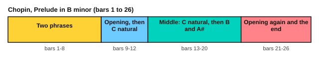

# Chopin: Prelude in B minor

<span class="tag tag-piano">Piano</span> <span class="tag tag-stretch">Stretch piece</span>

After this lesson you can play, or work towards, Chopin's Prelude in B minor, Op. 28 No. 6, with the melody in the left hand and soft repeated chords in the right.

Before this: [Schumann: The Happy Farmer](../08-fretboard-barre-chords-and-caged/10-the-happy-farmer.md), [Voicing the melody](../07-pedal-texture-and-ambient/09-voicing-the-melody.md), [Legato pedalling](../07-pedal-texture-and-ambient/02-legato-pedalling.md), [Chopin: Prelude in E minor](04-chopin-prelude-in-e-minor.md), [Phrases and form](02-phrases-and-form.md). You need: your piano with its damper pedal, and a metronome.

This is a stretch piece, above the book's main target (roughly RCM 7 to 8). The notes are not fast, but the left hand must sing and play a bass at once while the right hand stays very soft. If it is too much now, return to it later.

## The idea

### The piece

This is No. 6 of Chopin's 24 preludes, Op. 28. It is in B minor, which has two sharps (F# and C#), and in 3/4. The score is marked Assai lento, "very slow", and the play bar uses 45 for a quarter note. It has 26 bars.

The right hand repeats a soft chord in eighth notes, six to a bar. The left hand has the tune, marked molto cantato (very singing): it starts each phrase with a quick rise of four notes, then sings a melody above the bass note. In the score, "sotto voce" under the right hand means "in an undertone". The first bar marks an accent on each beat of the right-hand chord, and the next bar says simile, "keep doing the same".

```abc
X:1
T:Prelude in B minor, Op. 28 No. 6
C:Frederic Chopin (1810-1849)
M:3/4
L:1/16
Q:1/4=45
K:Bm
%%score {(RH RH2) LH}
V:RH clef=treble
V:RH2 clef=treble
V:LH clef=bass
V:RH
"^Assai lento"!accent!B2B2 !accent!B2B2 !accent!B2B2 | "^(simile)"B2B2 B2B2 B2B2 | B2B2 d2d2 d2d2 | d2d2 d2d2 d2d2 |
V:RH2
!p!"_sotto voce"[DF]4 F4 F4 | [DF]4 [DF]4 [DF]4 | [DF]4 B4 B4 | [FB]4 [FB]4 [FB]4 |
V:LH
B,,D,F,B, "_molto cantato"D4 C3D | B,6 F,2 D,2C,2 | B,,F,B,D F4 E3F | D6 B,2 F,2D,2 |
V:RH
d2d2 d2d2 d2d2 | d2d2 c2c2 [^Ac]2[Bd]2 | e6 [Fcf]2 edcB | [C^^F^A]2[D^GB]2 [DBd]2[CAc]2 z4 |
V:RH2
[GB]4 B4 B4 | [^GB]4 [GB]4 =G4 | [G^A]2[GB]2 [GA]2x2 [FB]2F2 | x12 |
V:LH
G,,D,B,D G4 F4 | F4 ^E4 =E2D2 | C2D2 C2^A,2 B,2D,2 | E,2^E,2 F,4 D,2C,2 |
V:RH
B2B2 B2B2 B2B2 | B2B2 B2B2 B2B2 | B2B2 B2B2 B2B2 | =c2c2 c2c2 c2c2 |
V:RH2
[DF]4 F4 F4 | [DF]4 [DF]4 [DF]4 | [DG]4 G4 G4 | G4 [EG]4 [EG]4 |
V:LH
B,,D,F,B, D4 C3D | B,6 F,2 D,2B,,2 | G,,D,G,B, D4 E2=F2 | E6 =C2 G,2=C,2 |
V:RH
=c2c2 c2c2 c2c2 | =c2c2 c2c2 B2B2 | ^A2A2 A2A2 B2B2 | B2B2 ^A2A2 B2B2 |
V:RH2
[EG]4 G4 [EG]4 | G4 G4 G4 | !p![CG]4 [CF]4 [DF]4 | [CG]4 [CG]4 [DG]4 |
V:LH
=C,,G,,E,G, E4 C,,G,,E,G, | E8 z4 | E,6 F,2 E,D,C,B,, | E,6 F,2 E,D,C,B,, |
V:RH
B2B2 B2B2 ^A2A2 | ^A2A2 B2B2 B2B2 | B2B2 ^A2A2 B2B2 | B2B2 ^A2A2 B2B2 |
V:RH2
[DG]4 [CF]4 [CE]4 | [CE]4 [B,D]4 [DG]4 | [CG]4 [CG]4 [DF]4 | [CG]4 [CG]4 [DG]4 |
V:LH
A,,G,,D,,E,, F,,8 | G,,8 G,4 | E,6 F,2 E,D,C,B,, | E,6 F,2 E,D,C,B,, |
V:RH
B2B2 B2B2 ^A2A2 | B2B2 B2B2 !accent!A2A2 | F2F2 F2F2 F2F2 | F2F2 F2F2 F2F2 |
V:RH2
[DG]4 [CF]4 [CF]4 | !pp![DF]4 [DF]4 [DF]4 | D4 x8 | D4 D4 D4 |
V:LH
A,,G,,D,,E,, F,,8 | B,,,12- | B,,,B,,F,B, D4 C3D | B,6 F,2 D,2C,2 |
V:RH
F2F2 z4 F2F2 | F2F2 z8 |]
V:RH2
D4 x4 !ppp!D4 | D4 x8 |]
V:LH
B,,12- | B,,4 z8 |]
```

Source: Mutopia Project Mutopia-2015/01/17-469 (maintainer Magnus Lewis-Smith), Public Domain, from the Edition Peters.

### Form by bar number



| Bars | What happens |
|---|---|
| 1 to 4 | First phrase: the left hand rises and sings, and the right hand repeats B and D chords |
| 5 to 8 | Second phrase. The left hand starts on G, and the score has E# in bars 6 and 8 and F## (F double sharp, the same key as G) in bar 8 |
| 9 to 12 | Bar 9 repeats bar 1 in the left hand and bar 10 is close to bar 2. The right hand has C natural from bar 12 |
| 13 to 20 | The middle part. C natural stays in the right hand until bar 14, then the right hand returns to B and A#. Bar 19 is marked p |
| 21 to 26 | Bar 22 is marked pp with an accent on its last beat. Bars 23 and 24 echo the opening left-hand tune. Bar 25 is ppp, and the last bars rest on a held B in the bass |

## Hard spots

| Bars | Why they are hard | What to do |
|---|---|---|
| 1, 3, 9, 11, 13, 23 | The left hand rises through four fast notes, then sings | Practise the four notes as one gesture with the pedal, then land the first melody note on beat 2 with a clear sound. Try fingers 5, 3, 2, 1 and see what fits your hand |
| 1 to 26 | The right hand repeats a chord six times a bar and must stay quieter than the left-hand melody | Play the right hand alone at pp. Hold the notes down lightly, wrist loose |
| 6 and 8 | E# and F## | Say the note names aloud. E# is the same key as F, and F## is the same key as G |
| 12 to 15 | C natural in the right hand, away from B minor | Mark every C natural with a pencil |
| 25 to 26 | Very quiet right-hand repeated notes (ppp), then silence | Let the last bass note ring and watch the rests in bar 26 |

Fingering for the left-hand melody should keep it joined. The melody often moves by step, so use finger changes on held notes, and pedal to join the rest. The right hand needs one thing: the same light touch on every chord.

Here is a short exercise in the same texture, written for this lesson. The right hand repeats a B minor chord, and the left hand has a four-note melody.

```abc
X:1
M:3/4
L:1/8
Q:1/4=45
K:Bm
%%score {RH LH}
V:RH clef=treble
V:LH clef=bass
V:RH
!pp![DFB] [DFB] [DFB] [DFB] [DFB] [DFB] | [DFB] [DFB] [DFB] [DFB] [DFB] [DFB] |]
V:LH
!mp!B,,2 D,2 F,2 | G,4 F,2 |]
```

### Pedalling

The page's score has no pedal marks. This is a suggestion.

1. Change the pedal on the left-hand bass note at the start of each bar.
2. Change it again where the melody moves to a note that clashes with the old harmony.
3. Listen: the right-hand chord should sound as one soft cloud and the melody should stay clear.

### Plan for six weeks

| Week | Bars | Aim |
|---|---|---|
| 1 | 1 to 4 | Left hand alone, then right hand alone at pp |
| 2 | 5 to 8 | Same method, with the spelled notes marked |
| 3 | 9 to 12 | Join 1 to 12 |
| 4 | 13 to 20 | The middle part, with the C naturals |
| 5 | 21 to 26 | The return and the ending |
| 6 | All | Whole piece at 45 for the quarter note, with pedal; record it |

## Try it

Exercise 1. How many sharps does the key signature have, and which notes?

<details class="solution" markdown>
<summary>Answer</summary>

Two sharps, F# and C#. B minor has two sharps.

</details>

Exercise 2. How many right-hand chords are in a bar of 3/4 in this piece?

<details class="solution" markdown>
<summary>Answer</summary>

Six, one for each eighth note.

</details>

Exercise 3. Which bars echo the opening tune in the left hand after bar 4?

<details class="solution" markdown>
<summary>Answer</summary>

Bars 9 and 10, and again bars 23 and 24, with small changes.

</details>

<div class="practice" markdown>

### Practice routine (30 minutes)

| Minutes | What to do | Tempo | Listen for |
|---|---|---|---|
| 5 | Warm-up: B minor scale (natural and harmonic), one octave, hands separately | 60 bpm | Even notes |
| 15 | The section of the week: left hand alone, right hand alone, then together | 40 bpm for the quarter note | The left hand louder than the right |
| 5 | Sight reading: a slow piece with a tune in the bass clef | 50 bpm | Keep going after a wrong note |
| 5 | Guitar: Bm and Em chord changes, one chord per bar | 60 bpm | Every string rings |

Repeat on most days. Each week, move the 15 minutes to the next section.

</div>

<div class="move-on" markdown>

### Move on when

- [ ] You can play bars 1 to 8 hands together at 40 for the quarter note, with the left hand louder than the right, three times in a row.
- [ ] You can play the whole piece at 40 with no stops.
- [ ] You can name E# and F## and say which keys they match.
- [ ] You can point to the four sections by bar number.

</div>

## Common mistakes

Letting the right-hand chords grow louder. Their level is soft all the way through, and the tune lives in the left hand.

Letting the melody drop out after the rising notes. The rise leads to the first melody note, so aim for it.

Playing the rests in the last bars short. Count them.

## Key terms

- **Assai lento**: very slow.
- **Molto cantato**: very singing.
- **Sotto voce**: in an undertone, very quiet.
- **Simile**: keep doing the same thing.
- **Double sharp**: a sign that raises a note by two half steps.

Next: [Satie: Gymnopédie No. 1](07-satie-gymnopedie-1.md)
