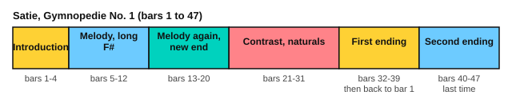

# Satie: Gymnopédie No. 1

<span class="tag tag-piano">Piano</span> <span class="tag tag-stretch">Stretch piece</span>

After this lesson you can play, or work towards, Satie's Gymnopédie No. 1: a slow waltz bass, a quiet melody over it, and one pedal change a bar.

Before this: [The damper pedal](../07-pedal-texture-and-ambient/01-damper-pedal.md), [Legato pedalling](../07-pedal-texture-and-ambient/02-legato-pedalling.md), [Seventh chords on piano](../09-harmony/05-seventh-chords-on-piano.md), [Phrases and form](02-phrases-and-form.md), [Articulation and repeat signs](../06-meter-terms-and-rhythm/04-articulation-and-repeat-signs.md). You need: your piano with its damper pedal, and a metronome.

This is a stretch piece, above the book's main target (roughly RCM 7 to 8), mostly because of control: a very slow tempo, an even touch, and a whole page of quiet. It has fewer notes than the other three stretch pieces, so it is a good one to try first. You can also come back to it later.

## The idea

### The piece

Erik Satie published the first of his three Gymnopédies in 1888. It is in 3/4, with a key signature of two sharps (F# and C#), and it is marked Lent et douloureux, French for "slow and sorrowful". The play bar uses 60 for a quarter note. It has 47 bars.

The left hand plays a bass note on beat 1 and a chord on beats 2 and 3. The first two bars show the pattern: a low G with a chord of B, D and F#, and then a low D with a chord of A, C# and F#. Together they make Gmaj7 (G, B, D, F#) and Dmaj7 (D, F#, A, C#). In this score the chords are written in the treble staff, but once the melody starts they must go to the left hand, which jumps up from the bass note. The melody is in the right hand, from bar 5.

```abc
X:1
T:Gymnopedie No. 1
C:Erik Satie (1866-1925)
M:3/4
L:1/8
Q:1/4=66
K:D
%%score {(RH RH2) (LH LH2)}
V:RH clef=treble
V:RH2 clef=treble
V:LH clef=bass
V:LH2 clef=bass
V:RH
|: "^Lent et douloureux"z2 [B,DF]4 | z2 [A,CF]4 | z2 [B,DF]4 | z2 [A,CF]4 |
V:RH2
|: x6 | x6 | x6 | x6 |
V:LH
|: G,,6 | D,,6 | G,,6 | D,,6 |
V:LH2
|: x6 | x6 | x6 | x6 |
V:RH
z2 !pp!(!crescendo(!f2 a2 | g2 f2 c2 | B2 !crescendo)!c2 !diminuendo(!d2 | A6 |
V:RH2
x2 [B,DF]4 | x2 [A,CF]4 | x2 [B,DF]4 | x2 [A,CF]4 |
V:LH
G,,6 | D,,6 | G,,6 | D,,6 |
V:LH2
x6 | x6 | x6 | x6 |
V:RH
!diminuendo)!F2) F4- | F2 F4- | F2 F4- | F2 [A,CF]4 |
V:RH2
x2 !f![B,D]4 | x2 [A,C]4 | x2 [B,D]4 | x6 |
V:LH
G,,6 | D,,6 | G,,6 | D,,6 |
V:LH2
x6 | x6 | x6 | x6 |
V:RH
z2 (!crescendo(!f2 a2 | g2 f2 c2 | B2 c2 !crescendo)!d2 | !diminuendo(!A6 |
V:RH2
x2 !pp![B,DF]4 | x2 [A,CF]4 | x2 [B,DF]4 | x2 [A,CF]4 |
V:LH
G,,6 | D,,6 | G,,6 | D,,6 |
V:LH2
x6 | x6 | x6 | x6 |
V:RH
c6 | f6 | !diminuendo)!E6-) | E6- |
V:RH2
x2 [A,CF]4 | x2 [B,DF]4 | x6 | x6 |
V:LH
F,,6 | B,,,6 | E,,6 | E,,6 |
V:LH2
x6 | x6 | x2 [G,B,]4 | x2 [B,DG]4 |
V:RH
E6 | (!crescendo(!A2 B2 =c2 | e2 d2 B2 | d2 =c2 !crescendo)!B2 |
V:RH2
x6 | x6 | x6 | x6 |
V:LH
D,,6 | A,,,6 | D,,6 | D,,6 |
V:LH2
x2 [=F,A,D]4 | x2 [A,=CE]4 | x2 [G,B,E]4 | x2 [D,G,B,E]4 |
V:RH
!diminuendo(!d6- | d4)!diminuendo)! (!crescendo(!d2 | e2 =f2 g2 | a2 =c2 !crescendo)!d2 |
V:RH2
x6 | x6 | x6 | x6 |
V:LH
D,,6 | D,,6 | D,,6 | D,,6 |
V:LH2
x2 [=C,E,A,D]4 | x2 [=C,F,A,D]4 | x2 [A,=C=F]4 | x2 [A,=CE]4 |
V:RH
!diminuendo(!e2 d2 B2 | !diminuendo)!d6- | d4) d2 |[1 (!crescendo(!g6 |
V:RH2
x6 | x6 | x6 |[1 x2 [B,EG]4 |
V:LH
D,,6 | D,,6 | D,,6 |[1 E,,6 |
V:LH2
x2 [D,G,B,E]4 | x2 [=C,E,A,D]4 | x2 [=C,F,A,D]4 |[1 x6 |
V:RH
!crescendo)!f6 | B2 A2 B2 | c2 d2 e2 | c2 !diminuendo(!d2 e2 |
V:RH2
x2 [A,CF]4 | x2 [B,DF]4 | x2 [CEA]4 | x2 [A,CFA]4 |
V:LH
F,,6 | B,,,6 | E,,6 | E,,6 |
V:LH2
x6 | x6 | x6 | x6 |
V:RH
F6 | !diminuendo)![=CEA=c]6) | [DFAd]6 :|[2 (!crescendo(!g6 |
V:RH2
x2 [A,D]2 [B,DG]2 | x6 | x6 :|[2 x2 [B,EG]4 |
V:LH
E,,6 | [A,,G,]6 | [D,,A,,D,]6 :|[2 E,,6 |
V:LH2
x2 B,,2 E,2 | x6 | x6 :|[2 x6 |
V:RH
!crescendo)!=f6 | B2 =c2 =f2 | e2 d2 =c2 | e2 d2 !diminuendo(!=c2 |
V:RH2
x2 [A,D=FA]4 | x2 [A,=C=F]4 | x2 [=CEA]4 | x2 [A,=C=FA]4 |
V:LH
E,,6 | E,,6 | E,,6 | E,,6 |
V:LH2
x6 | x6 | x6 | x6 |
V:RH
=F6 | [=CEA=c]6 | !diminuendo)![D=FAd]6) |]
V:RH2
x2 [A,D]2 [B,DG]2 | x6 | x6 |]
V:LH
E,,6 | [A,,G,]6 | [D,,A,,D,]6 |]
V:LH2
x2 B,,2 E,2 | x6 | x6 |]
```

Source: Mutopia Project Mutopia-2014/12/14-37 (typeset by Evin Robertson), Public Domain per Mutopia (IMSLP lists CC BY 3.0, credit Robertson), from the Dover edition.

### Form by bar number



| Bars | What happens |
|---|---|
| 1 to 4 | Introduction: the bass and chord pattern alone, no melody |
| 5 to 12 | The melody enters, marked pp, then a long held F# in bars 9 to 12 (the score ties it from bar to bar) |
| 13 to 20 | The melody again, the same for four bars, then it moves differently and settles on a held E in bars 19 to 21 |
| 21 to 31 | A contrasting part with natural signs (C natural, F natural) and a rising and falling melody |
| 32 to 39 | First ending |
| 40 to 47 | Second ending, played after the repeat |

There is a repeat sign at the start. After bar 39 you go back to bar 1, play to bar 31, and then play the second ending, bars 40 to 47. The play bar follows the repeat. The two endings are alike but not the same: the second has more natural signs, such as F natural in bar 41. Both end on a D major chord.

The score has hairpins (crescendo and diminuendo signs) over each phrase and no dynamic above the quiet level. Keep the whole piece soft.

## Hard spots

| Bars | Why they are hard | What to do |
|---|---|---|
| 1 to 47 | The left hand leaps from a bass note to a chord, more than an octave | Practise the leap alone, looking at the chord keys before you move, and aim to land softly |
| 5 to 8, 13 to 16 | The melody must stay above the chords | Play the melody alone and listen to the shape. Then add the chords softly |
| 9 to 12 | A long held note while the left hand keeps going | Count "1 2 3" in each bar and keep the finger on the key |
| 21 to 31 | New accidentals (naturals) and a wider melody | Mark every natural in pencil and play the bars hands separately |
| 32 to 47 | Two endings that look alike | Write "1st" and "2nd" above the bars and play each ending alone |

Here is a short exercise in the same texture, written for this lesson: a bass note and a chord in the left hand, practised alone.

```abc
X:1
M:3/4
L:1/8
Q:1/4=60
K:D
V:LH clef=bass
V:LH
!pp!E,,2 [G,B,D]4 | A,,2 [G,CE]4 |]
```

### Pedalling

The page's score has no pedal marks. A common approach is one pedal per bar.

1. Play the bass note on beat 1, then press the pedal.
2. Play the chord on beats 2 and 3 with the pedal down, so bass and chord sound together.
3. Lift the pedal as you play the next bass note, and press it again right after.
4. Listen: the bass note of the old bar must stop before the new one sounds.

### Plan for six weeks

| Week | Bars | Aim |
|---|---|---|
| 1 | 1 to 4 | The left-hand pattern alone, with the pedal, at 50 |
| 2 | 5 to 12 | Melody alone, then add the left hand |
| 3 | 13 to 20 | Same method |
| 4 | 21 to 31 | The contrasting part |
| 5 | 32 to 47 | Both endings and the repeat |
| 6 | All | Whole piece at 50 and then 60, with pedal; record it |

## Try it

Exercise 1. What chord do the notes B, D and F# above a G in the bass make together?

<details class="solution" markdown>
<summary>Answer</summary>

Gmaj7: G, B, D, F#.

</details>

Exercise 2. In which bars does the first ending play?

<details class="solution" markdown>
<summary>Answer</summary>

Bars 32 to 39. After bar 39 you go back to bar 1.

</details>

Exercise 3. Which bars are the introduction?

<details class="solution" markdown>
<summary>Answer</summary>

Bars 1 to 4.

</details>

<div class="practice" markdown>

### Practice routine (30 minutes)

| Minutes | What to do | Tempo | Listen for |
|---|---|---|---|
| 5 | Warm-up: D major scale, two octaves, hands separately | 66 bpm | Even notes |
| 15 | The section of the week: left hand, then melody, then together, with pedal | 50 bpm | Bass and chord sound together, with no blur from the old bar |
| 5 | Sight reading: a slow piece in 3/4 | 50 bpm | Keep going after a wrong note |
| 5 | Guitar: Em7 and A7 shapes, one chord per bar | 60 bpm | Every string rings |

Repeat on most days. Each week, move the 15 minutes to the next section.

</div>

<div class="move-on" markdown>

### Move on when

- [ ] You can play bars 1 to 12 hands together at 50 for the quarter note, three times in a row with no stops.
- [ ] You can play the whole piece with the repeat and the second ending at 50.
- [ ] You can record yourself and hear that no bass note blurs into the next bar.
- [ ] You can say the key signature, the time signature and the sections by bar number.

</div>

## Common mistakes

Hurrying the slow tempo. Count the three beats in every bar aloud at first.

Playing the chord as loud as the bass note. The chord is quiet and the bass note comes first.

Leaving the pedal down across bars. Change it with each new bass note.

## Key terms

- **Lent et douloureux**: French for "slow and sorrowful".
- **Gymnopédie**: the title Satie gave to three slow piano pieces.
- **Hairpin**: a sign for a gradual crescendo or diminuendo.

Next: [Playing by ear](08-playing-by-ear.md)
