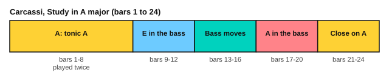

# Carcassi: Study in A major

<span class="tag tag-guitar">Guitar</span> <span class="tag tag-optional">Optional</span>

After this lesson you can play, or work towards, Carcassi's Study in A major, Op. 60 No. 3, with a bass note, triplet arpeggios and a melody in the top voice.

Before this: [Carcassi: a study from Opus 60](../10-classical-repertoire/05-carcassi-op-60.md), [Fingerpicking patterns](../06-meter-terms-and-rhythm/07-fingerpicking-patterns.md), [Triplets and syncopation](../06-meter-terms-and-rhythm/02-triplets-and-syncopation.md), [Reading higher up the neck](../08-fretboard-barre-chords-and-caged/07-fretboard-reading.md), [Phrases and form](02-phrases-and-form.md). You need: your guitar and a metronome.

This lesson is optional. The study is about a grade above the earlier studies in stage 10, because three layers play at once and the left hand reaches fret 10. It has no stretch tag, but treat it as a challenge and come back to it if it feels too hard now.

## The idea

### The piece

Matteo Carcassi (1792 to 1853) wrote 25 Melodious and Progressive Studies, Op. 60. This is No. 3. It is in A major, which has three sharps (F#, C# and G#), and in 4/4. The play bar uses 66 for a quarter note and the score is shown as written for guitar, an octave above the sound. It has 24 bars.

Every beat is a triplet of eighth notes, a group of three notes in the time of two. In each beat a note starts the triplet (a bass note or a melody note), and two notes of the arpeggio follow: A and C# in bar 1, played on strings 3 and 2. The melody sits on top, mostly on string 1, and the bass sits on the lowest strings.

```abc
%%opts tab=guitar sound=nylon
X:1
T:Etude No. 3 (25 Melodious and Progressive Studies, Op. 60)
C:Matteo Carcassi (1792-1853)
M:4/4
L:1/16
Q:1/4=66
K:A
%%score (Melody Melody2 Melody3)
V:Melody clef=treble-8
V:Melody2 clef=treble-8
V:Melody3 clef=treble-8
V:Melody
|: A,12 A,4 | G,12 G,4 | E,12 E,4 | A,12 A,4 |
V:Melody2
|: (3x2A2c2 f4 e4 (3x2x2c2 | (3x2B2d2 f4 e4 (3x2x2d2 | (3x2x2d2 a4 g4 x4 | x4 b4 a4 x4 |
V:Melody3
|: (3x2x2x2 (3x2A2c2 (3x2A2c2 (3x2A2x2 | (3x2x2x2 (3x2B2d2 (3x2B2d2 (3x2B2x2 | (3x2B2x2 (3x2B2d2 (3x2B2d2 (3x2B2d2 | (3x2c2e2 (3x2c2e2 (3x2c2e2 (3x2c2e2 |
V:Melody
A,12 A,4 | ^A,12 A,4 | B,8 B,8 | E,12 z4 ::
V:Melody2
x4 g4 f4 (3x2x2x2 | (3x2x2c2 f4 e4 (3x2x2c2 | x4 e4 x4 ^d4 | x4 (3e2x2x2 (3x2x2x2 (3x2x2x2 ::
V:Melody3
(3x2A2c2 (3x2A2c2 (3x2A2c2 (3x2A2c2 | (3x2=G2x2 (3x2G2c2 (3x2G2c2 (3x2G2x2 | (3x2F2A2 (3x2F2A2 (3x2F2A2 (3x2F2A2 | (3x2G2B2 (3x2G2B2 E4 (3x2x2x2 ::
V:Melody
E,12 z4 | E,12 z4 | E,12 z4 | E,12 (3z2z2z2 |
V:Melody2
(3x2x2x2 f4 e4 (3x2G2B2 | (3x2A2c2 g4 f4 (3x2A2c2 | (3x2^A2c2 =g4 f4 (3x2A2c2 | (3x2B2d2 a4 g4 (3x2B2d2 |
V:Melody3
(3x2G2B2 (3x2G2B2 (3x2G2B2 E4 | (3x2x2x2 (3x2A2c2 (3x2A2c2 E4 | (3x2x2x2 (3x2^A2c2 (3x2A2c2 E4 | (3x2x2x2 (3x2B2d2 (3x2B2d2 E4 |
V:Melody
(3z2z2z2 (3z2B2d2 (3z2B2d2 (3z2B2d2 | (3z2A2c2 (3z2A2c2 (3z2A2c2 (3z2A2c2 | (3z2d2z2 (3z2d2f2 (3z2d2f2 (3z2d2f2 | (3z2=f2g2 (3z2f2g2 c2d2 B2e2 |
V:Melody2
(3x2B2d2 a4 g4 x4 | x4 a4 x4 a4 | (3x2x2f2 b4 x4 =c'4 | x4 c'4 (3x2x2x2 (3x2x2x2 |
V:Melody3
^E12 E4 | F8 F8 | D8 D8 | C12 x4 |
V:Melody
(3z2A2c2 f4 e4 (3z2z2c2 | (3z2B2d2 a4 g4 z4 | z4 f4 e4 (3z2z2z2 | (3z2z2e2 b4 a4 (3z2c2e2 |
V:Melody2
(3x2x2x2 (3x2A2c2 (3x2A2c2 (3x2A2x2 | (3x2x2x2 (3x2B2d2 (3x2B2d2 (3x2B2d2 | (3x2G2B2 (3x2G2B2 (3x2G2B2 (3x2G2B2 | (3x2c2x2 (3x2c2e2 (3x2c2e2 A4 |
V:Melody3
A,12 A,4 | A,12 A,4 | A,12 A,4 | A,12 (3x2x2x2 |
V:Melody
(3z2c2e2 b4 ^a4 (3z2c2e2 | (3z2d2f2 c'4 b4 d'4 | (3z2A2B2 ^e4 (3z2G2d2 =e4 | (3z2c2e2 a4 z8 :|]
V:Melody2
F12 F4 | D16 | ^D8 E8 | A,8 x8 :|]
V:Melody3
(3x2x2x2 (3x2c2e2 (3x2c2e2 (3x2x2x2 | (3x2x2x2 (3x2d2f2 (3x2d2f2 (3x2d2f2 | (3x2x2x2 (3x2A2B2 (3x2x2x2 (3x2G2d2 | (3x2x2x2 (3x2c2e2 A4 x4 :|]
```

Source: Mutopia Project Mutopia-2015/08/18-14 (maintainer Jeff Covey), Public Domain, from the Schott edition (Mayence).

### Form by bar number



The study is in binary form, A B, and each half is repeated. In the first half, the bass in bars 1 to 4 goes A, G#, E, A, and bar 8 ends on E in the bass, the dominant of A, so the music asks to be played again.

| Bars | What happens |
|---|---|
| 1 to 8 | First half, repeated. The bass note is held for three beats and struck again on beat 4 in most bars. Bar 4 returns to A, and bar 8 ends on E |
| 9 to 12 | The bass stays on E for four bars (a [pedal point](../11-film-game-and-anime-harmony/07-pedal-points-and-ostinatos.md)) |
| 13 to 16 | The triplets move to the top voice and the bass changes bar by bar. The melody climbs step by step |
| 17 to 20 | The bass stays on A for four bars |
| 21 to 24 | The melody climbs to its highest notes, with C# and D in bar 22 up at frets 9 and 10 on string 1. The study ends on A in bar 24 |

The second half is repeated as one block, from bar 9 to bar 24.

## Hard spots

| Bars | Why they are hard | What to do |
|---|---|---|
| 1 to 8 | Three layers at once: bass, triplet and melody | Practise with p on the bass, i on string 3, m on string 2 and a on string 1. Play bar 1 as bass alone, then add the triplets |
| 13 to 16 | The triplets move to the top voice | Play the right hand alone, one bar at a time |
| 18, 20 and 22 | The left hand climbs to frets 7 to 10 on string 1 | Move the whole hand as one unit and look at the fret markers |
| 21 to 24 | Fast climb and a high ending | Practise bars 21 to 24 alone with the metronome |
| 24 | The last notes must stop together | Touch the strings after the final A |

Right-hand fingering: p plays the bass notes, i plays string 3, m plays string 2 and a plays string 1. In the opening bars, the F# and E melody notes on string 1 are played with a. The notes are written an octave above where they sound, and the tab under the score on the site shows frets.

Here is a short exercise in the same texture, written for this lesson. Each beat has a bass note, then two arpeggio notes, with a melody on the second beat.

```abc
%%opts tab=guitar sound=nylon
X:1
M:4/4
L:1/16
Q:1/4=60
K:A clef=treble-8
%%score (Melody Melody2)
V:Melody clef=treble-8
V:Melody2 clef=treble-8
V:Melody
A,12 A,4 | E,12 E,4 |]
V:Melody2
(3x2A2c2 e4 c4 (3x2x2e2 | (3x2B2d2 e4 d4 (3x2x2d2 |]
```

### Plan for four weeks

| Week | Bars | Aim |
|---|---|---|
| 1 | 1 to 4 | Bass and triplets without the melody at 50 bpm, then add the melody |
| 2 | 5 to 8 | Same method, then join with the first four bars |
| 3 | 9 to 16 | The middle part, one four-bar group at a time |
| 4 | 17 to 24 | The climb and the ending, then play it all with the repeats at 60 |

## Try it

Exercise 1. How many notes are in each beat of this study?

<details class="solution" markdown>
<summary>Answer</summary>

Three: each beat is a triplet. Some of its notes are rests or are held from a note in another voice.

</details>

Exercise 2. What are the sharps in the key signature?

<details class="solution" markdown>
<summary>Answer</summary>

F#, C# and G#. A major has three sharps.

</details>

Exercise 3. Which note is in the bass in bars 9 to 12?

<details class="solution" markdown>
<summary>Answer</summary>

E, the dominant of A major.

</details>

<div class="practice" markdown>

### Practice routine (30 minutes)

| Minutes | What to do | Tempo | Listen for |
|---|---|---|---|
| 5 | Warm-up: free-stroke arpeggios p i m a on strings 4 to 1 | 60 bpm | Even volume on every finger |
| 15 | The section of the week: bass alone, triplets alone, then together | 50 bpm | The melody louder than the arpeggio |
| 5 | Sight reading: a first-line exercise from stage 8 | 50 bpm | Keep going after a wrong note |
| 5 | Piano: Minuet in G, hands together | 80 bpm | A steady beat |

Repeat on most days. Each week, move the 15 minutes to the next section.

</div>

<div class="move-on" markdown>

### Move on when

- [ ] You can play bars 1 to 8 at 60 for the quarter note, three times in a row with no stops.
- [ ] You can play the whole study with the repeats at 60.
- [ ] You can play the melody notes louder than the arpeggio notes.
- [ ] You can say the key, the time signature and the form by bar number.

</div>

## Common mistakes

Playing all the notes at the same volume. Practise the melody with a first and let the arpeggio notes be softer.

Rushing the triplets. Count "1 trip let" for each beat.

Changing position late for the climb. Look ahead one bar and move before the beat.

## Key terms

- **Study** (etude): a piece written to practise one technique.
- **Triplet**: three notes played in the time of two.
- **Pedal point**: a held bass note under changing harmony.

Next: [Bach for guitar: a bourrée](10-bach-for-guitar.md)
