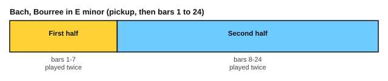

# Bach for guitar: a bourrée

<span class="tag tag-guitar">Guitar</span>

After this lesson you can play, or work towards, the Bourrée in E minor from Bach's Lute Suite BWV 996, as a melody with a bass line, in two repeated halves.

Before this: [The Minuet in G on guitar](../10-classical-repertoire/09-bach-minuet-for-guitar.md), [Fretboard reading](../08-fretboard-barre-chords-and-caged/07-fretboard-reading.md), [Natural minor](../05-minor-keys-and-chord-charts/01-natural-minor.md), [Phrases and form](02-phrases-and-form.md), [Articulation and repeat signs](../06-meter-terms-and-rhythm/04-articulation-and-repeat-signs.md). You need: your guitar and a metronome.

## The idea

### The piece

A **bourrée** is a quick dance in two beats to the bar. Johann Sebastian Bach (1685 to 1750) wrote this one in his Suite for lute, BWV 996, and it is a favourite of guitarists. It is in E minor, which has one sharp (F#), and in 2/2, the time signature with two half-note beats in a bar. The play bar uses 108 for a quarter note, which is fast. You will start at half that.

The piece begins with a one-beat pickup (two eighth notes) and has 24 bars after it. The tune is in the top voice, and a bass line runs underneath. Often a bass note and a melody note are struck together.

Two notes about the score on this page. Three low D notes in the lute original are lower than the guitar's low E string, so the score writes them an octave higher so they fit standard tuning. If you tune string 6 down to D (drop-D tuning), you can play the original bass, but do this only after you can play the piece in standard tuning.

```abc
%%opts tab=guitar sound=nylon
X:1
T:Bourree in E minor (BWV 996, from the Suite for lute)
C:Johann Sebastian Bach (1685-1750)
M:2/2
L:1/8
Q:1/4=108
K:Em
%%score (Melody Melody2)
V:Melody clef=treble-8
V:Melody2 clef=treble-8
V:Melody
[G,e][F,f] | [E,g]2 fe [B,^d]2 ef | [G,B]2 ^c^d [E,e]2 =d=c | [G,B]2 AG [B,F]2 GA |
V:Melody2
x2 | x2 A,2 x2 A,2 | x2 F,2 x2 F,2 | x2 A,2 x2 A,2 |
V:Melody
BA GF E2 [G,e][F,f] | [E,g]2 fe [B,^d]2 ef | [G,B]2 ^c^d [E,e]2 =d=c | [G,B]2 AG F3 G |
V:Melody2
G,2 B,2 E,F, x2 | x2 A,2 x2 A,2 | x2 F,2 x2 F,2 | x2 C2 D2 D2 |
V:Melody
[G,B,DG]6 BG | [F,d]2 Ac [G,B]2 gd | [Ce]2 Bd [A,c]2 BA | [E^G]2 AB [Ec]2 BA |
V:Melody2
x6 G,2 | x2 D2 x2 B,2 | x2 ^G,2 x2 D2 | x2 A,2 x2 E,2 |
V:Melody
A6 dA | [G,B]2 gd [Ce]2 Bd | [A,c]2 ae [Df]2 ^ce | [B,d]2 ^cB ^A3 B |
V:Melody2
A,B, A,G, F,2 D2 | x2 B,2 x2 ^G,2 | x2 ^C2 x2 ^A,2 | x2 E2 F2 F,2 |
V:Melody
B6 bf | [E^g]2 fe [^Ca]2 e=g | [Df]2 ed [B,g]2 d=f | [Ce]2 ae [A,f]2 ^ce |
V:Melody2
B,^A, B,^C ^D2 B,2 | x2 D2 x2 A,2 | x2 C2 x2 G,2 | x2 B,2 x2 F,2 |
V:Melody
^d2 B4 eB | c2 dA B2 cG | A2 BF [E,G]2 FE | [B,^D]2 EF G2 FE |
V:Melody2
B,3 C B,A, ^G,2 | A,E F2 G,^D E2 | F,^C ^D2 x2 A,2 | x2 A,2 B,4 |
V:Melody
[E,E]6 z2 |]
V:Melody2
x8 |]
```

Source: Mutopia Project Mutopia-2011/04/01-1743, Public Domain, from Denkmaeler alter Lautenkunst, Zwissler, 1921.

### Form by bar number



The bourrée is in binary form: two halves, and each half is played twice. The repeat signs in the lute score fall inside a bar, so the score on this page leaves them out. Play each half twice yourself.

| Bars | What happens |
|---|---|
| Pickup to 7 | First half. Phrases of about four bars, each starting on the last beat of a bar. Bar 4 ends on E in the middle of the bar, and bar 7 leads on |
| 8 to 24 | Second half. It opens with a G major chord (G, B, D, G) in bar 8, moves through higher notes around bars 16 to 19 and then comes home to E minor, with the final chord in bar 24 |

The bass and the melody are separate lines, so learn each alone before you play them together.

## Hard spots

| Bars | Why they are hard | What to do |
|---|---|---|
| Pickup and bars 1, 5 | A low bass note and a high melody note struck together, six strings apart | Pluck both at once with p and a. Practise the pair alone, ten times, before you add the next notes |
| 1 to 3 | Quick eighth notes with the bass on every second beat | Play the melody alone at 60 bpm for the quarter note, then add the bass |
| 8 | A four-note chord (G, B, D, G) then fast notes | Place the chord fingers first (fret 3 on string 6, fret 2 on string 5, strings 4 and 3 open), then play the next notes |
| 16 to 19 | Higher notes and a position change | Learn the new position with the metronome, then play the bars in context |
| 24 | Final chord | Let it ring, then stop the strings |

Picking-hand approach: p plays the bass strings 6 to 4, and i, m and a take the melody on strings 3 to 1. Left-hand fingers use one finger per fret in each position. Mark each position change on your copy so that it comes before the beat.

Here is a short exercise in the same texture, written for this lesson. It has a pickup, a melody over a bass, and a bass note and melody note struck together.

```abc
%%opts tab=guitar sound=nylon
X:1
M:2/2
L:1/8
Q:1/4=60
K:Em clef=treble-8
%%score (Melody Melody2)
V:Melody clef=treble-8
V:Melody2 clef=treble-8
V:Melody
[E,e]d | [B,c]2 BA [G,G]2 FE |]
V:Melody2
x2 | x2 A,2 x2 B,2 |]
```

### Plan for six weeks

| Week | Bars | Aim |
|---|---|---|
| 1 | Pickup to 3 | Melody alone at 50, then the bass alone |
| 2 | 4 to 7 | Same method, then join with the first three bars |
| 3 | 8 to 12 | The chord in bar 8 and the descent |
| 4 | 13 to 19 | The higher notes and the position change |
| 5 | 20 to 24 | The close, then each half twice |
| 6 | All | Whole piece with both repeats at 60, then 72, and later faster; record it |

## Try it

Exercise 1. How many sharps does the key signature have, and which note?

<details class="solution" markdown>
<summary>Answer</summary>

One, F#. E minor has one sharp.

</details>

Exercise 2. Why does the score on this page write three bass notes an octave higher than the lute original?

<details class="solution" markdown>
<summary>Answer</summary>

They are lower than the low E string in standard tuning. Raising them an octave makes them playable.

</details>

Exercise 3. How do you play the whole piece in order?

<details class="solution" markdown>
<summary>Answer</summary>

Pickup to bar 7 twice, then bars 8 to 24 twice.

</details>

<div class="practice" markdown>

### Practice routine (30 minutes)

| Minutes | What to do | Tempo | Listen for |
|---|---|---|---|
| 5 | Warm-up: E minor scale on strings 3 to 1, then free-stroke arpeggios | 60 bpm | Even notes |
| 15 | The section of the week: melody alone, bass alone, then together | 50 bpm for the quarter note | Bass and melody struck at the same instant |
| 5 | Sight reading: a first-line exercise from stage 8 | 50 bpm | Keep going after a wrong note |
| 5 | Piano: a piece from stage 8 | 72 bpm | Even notes |

Repeat on most days. Each week, move the 15 minutes to the next section.

</div>

<div class="move-on" markdown>

### Move on when

- [ ] You can play the first half at 60 for the quarter note, three times in a row with no stops.
- [ ] You can play the whole piece with both repeats at 60.
- [ ] You can play the bass and melody together at the same instant in bars 1 and 5.
- [ ] You can say the key, the time signature and the form by bar number.

</div>

## Common mistakes

Rushing the first half because the dance is fast. A slow, even start builds the speed.

Letting the bass note ring over the next melody note. Stop it with a finger when the harmony changes.

Forgetting the repeats. Each half is played twice.

## Key terms

- **Bourrée**: a quick dance in two beats to the bar.
- **Suite**: a set of dances played in order.
- **Drop-D tuning**: string 6 tuned down a whole step to D.

Next: [Play along with yourself](11-play-along-with-yourself.md)
