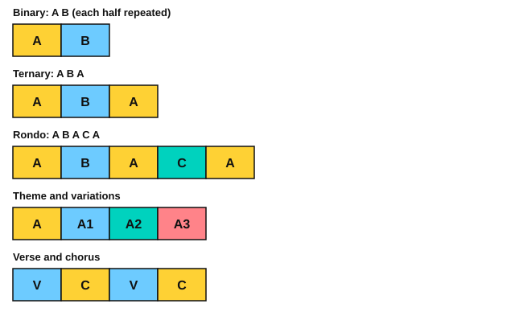

# Stage 13: Capstones

This stage ties the book together. You learn to transpose a melody and a chord progression, name the forms of music (phrase, period, binary, ternary, rondo, theme and variations, verse and chorus), and read the alto and tenor clefs if you want to. Then come four longer piano pieces by Chopin, Schumann and Satie, which are stretch pieces above the book's main target, and two guitar pieces, a Carcassi study and a Bach bourrée. You also learn a method for playing by ear, record one part and play another over it, and plan what to do after the book. By the end, you can learn a long piece from a score with a plan, and work out a tune by ear. It usually takes about 4 to 6 months at 30 minutes a day if you learn two pieces. Each piece takes 4 to 8 weeks, so choose the ones you want.

<!-- lessons:start -->
## Lessons

1. [Transposition](01-transposition.md) (theory)
2. [Phrases and form](02-phrases-and-form.md) (theory)
3. [The alto and tenor clefs](03-alto-and-tenor-clefs.md) (theory, optional)
4. [Chopin: Prelude in E minor](04-chopin-prelude-in-e-minor.md) (piano, stretch)
5. [Schumann: Träumerei](05-schumann-traumerei.md) (piano, stretch)
6. [Chopin: Prelude in B minor](06-chopin-prelude-in-b-minor.md) (piano, stretch)
7. [Satie: Gymnopédie No. 1](07-satie-gymnopedie-1.md) (piano, stretch)
8. [Playing by ear](08-playing-by-ear.md) (ear)
9. [Carcassi: Study in A major](09-carcassi-study-in-a-major.md) (guitar, optional)
10. [Bach for guitar: a bourrée](10-bach-for-guitar.md) (guitar)
11. [Play along with yourself](11-play-along-with-yourself.md) (other)
12. [What next](12-what-next.md) (other)

<!-- lessons:end -->

Download the stage 13 deck: [13-capstones.apkg](../downloads/anki/13-capstones.apkg)

## Cheat sheet

Everything to remember from this stage, on one page.

### Transposing

1. Name the old key and the new key.
2. Find the interval between the two tonics.
3. Move every note by that interval, keeping the quality.
4. Write the new key signature and check every accidental.

Or use numbers: read the scale degrees in the new key's scale.

| Interval between tonics | Half steps | I, vi, IV, V from C major |
|---|---|---|
| Up a perfect 4th | 5 | F, Dm, Bb, C |
| Up a perfect 5th | 7 | G, Em, C, D |
| Up a major 2nd | 2 | D, Bm, G, A |

A capo at fret 2 raises every shape by 2 half steps.

### Forms

| Term | Meaning |
|---|---|
| Phrase | A musical sentence ending at a resting point |
| Period | Two phrases: a question (antecedent) and an answer (consequent) |
| Binary | A B, each half usually repeated |
| Ternary | A B A |
| Rondo | A B A C A |
| Theme and variations | A, A1, A2, A3 |
| Verse and chorus | A changing verse and a returning hook |

### C clefs

| Clef | Middle C is on | Lines, bottom to top |
|---|---|---|
| Alto | Line 3 | F3, A3, C4, E4, G4 |
| Tenor | Line 4 | D3, F3, A3, C4, E4 |

### How to learn a long piece

1. Find the key and the time signature.
2. Find the form and mark the sections by bar number.
3. Mark the hard spots: accidentals, leaps, position changes, fast runs.
4. Split the piece into sections of two to four bars and write a plan in weeks.
5. Work hands separately, slowly, with a metronome. Three clean in a row before you speed up.
6. Join sections two at a time. Add pedal or picking patterns last.
7. Record the piece at the end of the plan and listen the next day.

### How to play by ear

1. Listen three times without playing. Hum along.
2. Find the key: the home note.
3. Find the first note and its scale degree.
4. Work out the melody a phrase at a time, as numbers.
5. Write the rhythm separately.
6. Find the bass notes on strong beats.
7. Test I, IV, V and vi under each melody note.
8. Write the numbers and chords, and transpose to a second key.
9. Play along with the recording and fix what clashes.
