# Guitar chord shapes

Use this page to find a chord shape quickly: the open chords from stages 1 to 9, power chords, and the movable E-shape and A-shape barre chords.

## How to read a chord diagram

The vertical lines are the strings, with string 6 (the thickest, low E) on the left and string 1 (the thinnest, high E) on the right. The horizontal lines are frets. A dot is where a finger presses, with the finger number inside it (1 is the index finger, 4 the little finger). An o above a string means play it open, an x means do not play it, and a salmon dot or circle marks the root. A number such as 3fr on the left means the diagram starts at that fret instead of the nut.

## Open chords

These are the chords used in the lessons. The frets and fingers columns list string 6 first; x means muted and a dash means no finger.

| Chord | Notes | Frets, string 6 to 1 | Fingers, string 6 to 1 |
|---|---|---|---|
| E | E, G#, B | 0 2 2 1 0 0 | - 2 3 1 - - |
| Em | E, G, B | 0 2 2 0 0 0 | - 2 3 - - - |
| A | A, C#, E | x 0 2 2 2 0 | - - 1 2 3 - |
| Am | A, C, E | x 0 2 2 1 0 | - - 2 3 1 - |
| D | D, F#, A | x x 0 2 3 2 | - - - 1 3 2 |
| Dm | D, F, A | x x 0 2 3 1 | - - - 2 3 1 |
| C | C, E, G | x 3 2 0 1 0 | - 3 2 - 1 - |
| G | G, B, D | 3 2 0 0 0 3 | 3 2 - - - 4 |
| A7 | A, C#, E, G | x 0 2 0 2 0 | - - 2 - 3 - |
| D7 | D, F#, A, C | x x 0 2 1 2 | - - - 2 1 3 |
| E7 | E, G#, B, D | 0 2 0 1 0 0 | - 2 - 1 - - |
| B7 | B, D#, F#, A | x 2 1 2 0 2 | - 2 1 3 - 4 |
| Cmaj7 | C, E, G, B | x 3 2 0 0 0 | - 3 2 - - - |
| Am7 | A, C, E, G | x 0 2 0 1 0 | - - 2 - 1 - |
| Fmaj7 | F, A, C, E | x x 3 2 1 0 | - - 3 2 1 - |
| Dsus2 | D, E, A | x x 0 2 3 0 | - - - 1 3 - |
| Dsus4 | D, G, A | x x 0 2 3 3 | - - - 1 3 4 |
| Asus2 | A, B, E | x 0 2 2 0 0 | - - 1 2 - - |
| Asus4 | A, D, E | x 0 2 2 3 0 | - - 1 2 3 - |
| Cadd9 | C, E, G, D | x 3 2 0 3 3 | - 2 1 - 3 4 |
| Em7 | E, G, B, D | 0 2 0 0 0 0 | - 2 - - - - |

### Major and minor

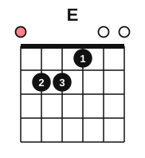
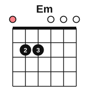
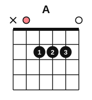
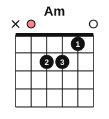
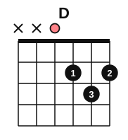
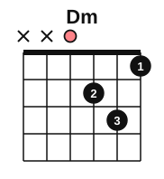
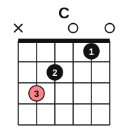
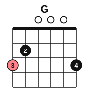

### Dominant 7th chords

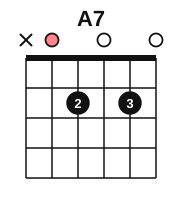
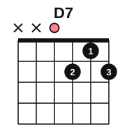
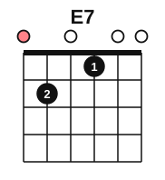
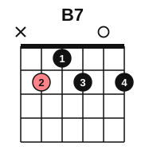

### Major 7th and minor 7th chords

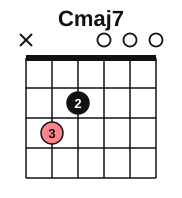
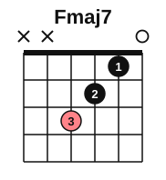
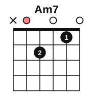
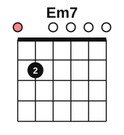

### Sus2, sus4 and add9 chords

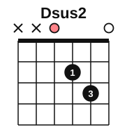
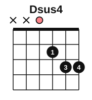
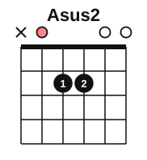
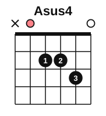
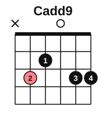

## Power chords

A power chord has two notes, the root and the 5th above it. Play only the strings with a number in the table; the x strings stay silent, and the same shape works on any fret.

| Chord | Notes | Frets, string 6 to 1 | Fingers, string 6 to 1 |
|---|---|---|---|
| E5 | E, B | 0 2 2 x x x | - 1 2 - - - |
| G5 | G, D | 3 5 5 x x x | 1 3 4 - - - |
| A5 | A, E | 5 7 7 x x x | 1 3 4 - - - |
| D5 | D, A | x 5 7 7 x x | - 1 3 4 - - |

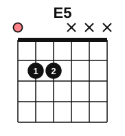

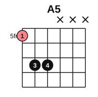
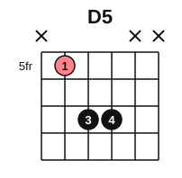

## Barre chords as movable shapes

A barre chord has no open strings, so the shape can slide up the neck and the root moves with it. The name of the chord comes from the note under the first finger of the barre. The E shape has its root on string 6 and the A shape has its root on string 5. The diagrams show each E shape as an F chord at fret 1 and each A shape as a C chord at fret 3.

### Which fret gives which root

Put the barre on the fret in the first column. The second column is the chord name for an E shape, the third for an A shape.

| Fret | E-shape root (string 6) | A-shape root (string 5) |
|---|---|---|
| 1 | F | A#/Bb |
| 2 | F#/Gb | B |
| 3 | G | C |
| 4 | G#/Ab | C#/Db |
| 5 | A | D |
| 6 | A#/Bb | D#/Eb |
| 7 | B | E |
| 8 | C | F |
| 9 | C#/Db | F#/Gb |
| 10 | D | G |
| 11 | D#/Eb | G#/Ab |
| 12 | E | A |

For example, an E-shape minor chord with the barre at fret 5 is Am, and an A-shape major chord with the barre at fret 5 is D.

### E-shape barre chords

The shapes in order are major, minor, dominant 7th, minor 7th and major 7th. In the major 7th shape, strings 5 and 1 are muted.

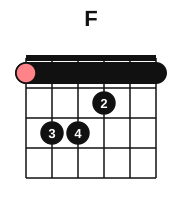
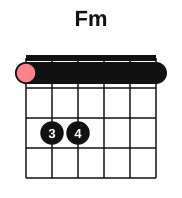
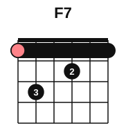
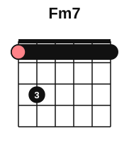
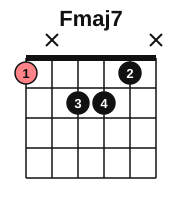

### A-shape barre chords

The shapes in order are major, minor, dominant 7th, minor 7th and major 7th. String 6 is muted in every A shape.

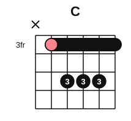
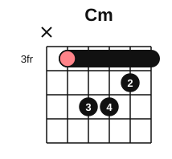
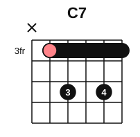
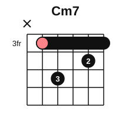
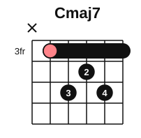
