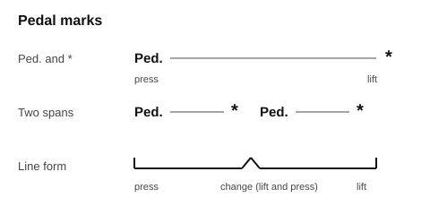
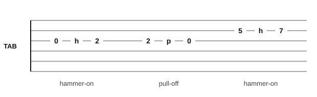
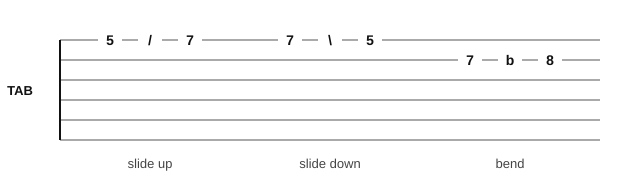

# Notation symbols

Use this page to look up a sign you meet on a score, to see its name and what it tells you to do. The signs are grouped by type, in roughly the order a score presents them.

## Staff and clefs

A **staff** is five horizontal lines and the four spaces between them. Lines and spaces are counted from the bottom. A note's height on the staff gives its pitch.

| Sign | Name | What it tells you |
|---|---|---|
| Five lines | Staff | Holds the notes; higher on the staff means higher in pitch |
| A tall curl that circles line 2 | Treble clef (G clef) | Line 2 is G4; used for the right hand on piano and for guitar music |
| A curl with two dots either side of line 4 | Bass clef (F clef) | Line 4 is F3; used for the left hand on piano |
| Two staves joined by a brace | Grand staff | Treble above, bass below; middle C sits between them on its own short line |
| A short line through a note head | Ledger line | Extends the staff for notes above or below it |
| `8` under a treble clef | Octave clef | The music sounds one octave lower than written; guitar music uses it |

```abc
%%opts play=off
X:1
M:4/4
L:1/4
K:C clef=treble
C E G c | e g c' z |]
```

```abc
%%opts play=off
X:1
M:4/4
L:1/4
K:C clef=bass
C, E, G, C | E G C z |]
```

## Notes and rests

A note's shape gives its length; a **rest** is a sign for silence of the same length. Lengths are given for 4/4 time, where a quarter note is one beat.

| Note | Rest | Beats in 4/4 |
|---|---|---|
| Whole note (open head, no stem) | Whole rest (hangs from line 4) | 4 |
| Half note (open head, stem) | Half rest (sits on line 3) | 2 |
| Quarter note (filled head, stem) | Quarter rest (a zigzag) | 1 |
| Eighth note (filled head, stem, one flag or beam) | Eighth rest (a dot and a flag) | 1/2 |
| Sixteenth note (two flags or beams) | Sixteenth rest (a dot and two flags) | 1/4 |

```abc
%%opts play=off
X:1
M:4/4
L:1/4
K:C
c4 | c2 c2 | c c c c | c/2c/2 c/2c/2 c/2c/2 c/2c/2 | z2 z z/2 z/4 z/4 |]
```

| Sign | Name | What it tells you |
|---|---|---|
| A dot after a note | Dotted note | Add half the note's length: a dotted half note lasts 3 beats |
| A curve joining two notes of the same pitch | Tie | Play one note, as long as the two together |
| A curve over notes of different pitches | Slur | Play the notes smoothly, with no gap (legato) |
| A 3 over three notes | Triplet | Three even notes in the time of two |

```abc
%%opts play=off
X:1
M:4/4
L:1/4
K:C
c3 c | c2- c2 | (c d e) f | (3cde f2 |]
```

## Accidentals and key signatures

An **accidental** changes a note by a half step. It lasts until the end of the bar. The book writes them as # and b in text.

| Sign | Name | What it tells you |
|---|---|---|
| Sharp, written # | Sharp | Raise the note one half step (F to F#) |
| Flat, written b | Flat | Lower the note one half step (B to Bb) |
| A natural sign | Natural | Cancel a sharp or flat: play the plain note |
| Two crossed lines like an x | Double sharp | Raise the note two half steps |
| Two flat signs | Double flat | Lower the note two half steps |
| Sharps or flats at the start of the staff | Key signature | Every note with that letter is sharp (or flat) throughout the piece |

```abc
%%opts play=off
X:1
M:4/4
L:1/4
K:C
^F =F _B =B | ^^F __B c2 |]
```

The key signature for G major has one sharp (F#) and for F major one flat (Bb). The [scales and key signatures page](scales-and-keys.md) lists all 15.

```abc
%%opts play=off
X:1
M:4/4
L:1/4
K:G
G A B c | [K:F] F G A B |]
```

## Time signatures

A **time signature** is two numbers at the start of the piece. The top number says how many beats are in each bar. The bottom number says which note value is one beat (4 for a quarter note, 8 for an eighth note).

| Sign | Name | What it tells you |
|---|---|---|
| 2/4 | Two-four | 2 quarter-note beats per bar |
| 3/4 | Three-four | 3 quarter-note beats per bar |
| 4/4 | Four-four | 4 quarter-note beats per bar |
| A letter C | Common time | The same as 4/4 |
| A letter C with a vertical line | Cut time (alla breve) | 2 half-note beats per bar, the same total as 4/4 but felt in two |
| 6/8 | Six-eight | 6 eighth notes per bar, felt as 2 beats of 3 |
| 9/8, 12/8 | Nine-eight, twelve-eight | 3 or 4 beats of 3 eighth notes |

```abc
%%opts play=off
X:1
M:3/4
L:1/4
K:C
c d e | f g a |]
```

```abc
%%opts play=off
X:1
M:6/8
L:1/8
K:C
c d e f g a | c'3 g3 |]
```

## Bar lines and repeats

A **bar line** is a vertical line that divides the staff into bars.

| Sign | Name | What it tells you |
|---|---|---|
| One thin line | Bar line | Ends a bar |
| Two thin lines | Double bar line | Ends a section |
| A thin line and a thick line | Final bar line | Ends the piece |
| Two dots left of a bar line | End repeat | Go back to the start repeat, or to the beginning if there is none |
| Two dots right of a bar line | Start repeat | The place to go back to |
| Brackets with 1 and 2 above the staff | First and second endings | Play ending 1, repeat, then skip it and play ending 2 |
| D.C. (da capo) | Da capo | Go back to the beginning |
| D.S. (dal segno) | Dal segno | Go back to the segno sign |
| An S with a slash and two dots | Segno | The place D.S. sends you back to |
| A circle with a cross | Coda | The closing section; jump to it at the "To Coda" sign |
| Fine | Fine | The end, when the piece stops after D.C. or D.S. al Fine |
| D.C. al Fine | Da capo al fine | Go back to the beginning and play to Fine |
| D.S. al Coda | Dal segno al coda | Go back to the segno, play to "To Coda", then jump to the coda |

```abc
%%opts play=off
X:1
M:4/4
L:1/4
K:C
|: C D E F | G A G2 |1 F E D2 :|2 F E C2 |]
```

## Dynamics

**Dynamics** say how loud to play. They are letters under the staff (piano and guitar) and shapes called hairpins.

| Sign | Name | What it tells you |
|---|---|---|
| pp | Pianissimo | Very soft |
| p | Piano | Soft |
| mp | Mezzo piano | Moderately soft |
| mf | Mezzo forte | Moderately loud |
| f | Forte | Loud |
| ff | Fortissimo | Very loud |
| sfz | Sforzando | A sudden strong accent |
| fp | Fortepiano | Loud, then at once soft |
| A hairpin that opens to the right | Crescendo (cresc.) | Gradually louder |
| A hairpin that closes to the right | Diminuendo (dim.) | Gradually softer |

```abc
%%opts play=off
X:1
M:4/4
L:1/4
K:C
!p!C D E F | !crescendo(!G A B c!crescendo)! | !f!c B A G | !diminuendo(!F E D C!diminuendo)! |]
```

## Articulation and ornaments

**Articulation** signs say how each note starts and ends. **Ornaments** are small decorations around a note.

| Sign | Name | What it tells you |
|---|---|---|
| A dot above or below the note head | Staccato | Short and detached |
| `>` above or below the note | Accent | Attack the note harder |
| A short line above or below the note | Tenuto | Hold the full length, with a slight lean |
| `^` above or below the note | Marcato | Strong and short |
| An arch with a dot under it | Fermata | Hold longer than written; the player chooses how long |
| A small note with a slash through its flag, before a main note | Grace note (acciaccatura) | A very quick note right before the main note |
| A zigzag with a vertical line through it | Mordent | The written note, the note below, the written note again, played quickly |
| A zigzag with no line | Upper mordent (inverted mordent) | The written note, the note above, the written note again, played quickly |
| tr over a note | Trill | Alternate quickly between the written note and the note above |
| A curve with a hook above a note | Turn | The note above, the written note, the note below, the written note |

```abc
%%opts play=off
X:1
M:4/4
L:1/4
K:C
!accent!c .d !tenuto!e !marcato!f | {B}c2 !fermata!d2 | !lowermordent!e2 !uppermordent!f2 | !trill!g4 |]
```

## Pedal marks

This book writes the damper pedal as text under the bottom staff. Ped. says to press the pedal and an asterisk (`*`) says to lift it. A lift followed at once by a new press is written `*Ped.`.

| Mark | Name | What it tells you |
|---|---|---|
| Ped. | Pedal down | Press the damper pedal (right pedal) after the note or chord sounds |
| `*` | Pedal up | Lift the pedal |
| `*Ped.` | Pedal change | Lift and press again straight away, as the harmony changes |
| una corda | Left pedal | Press the left pedal for a softer, thinner tone |
| tre corde | Release left pedal | Release the left pedal and return to the normal tone |
| sostenuto | Middle pedal | Holds only the notes that are down when you press it |



## Guitar tab marks

**Tab** (tablature) is six lines, one for each string, with string 1 (high e) at the top. A number is the fret to press, and 0 is an open string. The letters sit between two fret numbers on the same string.

| Mark | Name | What it tells you |
|---|---|---|
| 0 to 12 | Fret number | Press that fret on that string |
| 0 | Open string | Play the string without pressing a fret |
| `h` as in 5h7 | Hammer-on | Pick the first note, then press the second fret down hard without picking again |
| `p` as in 7p5 | Pull-off | Pick the first note, then pull the finger off sideways so the lower note sounds |
| `/` as in 5/7 | Slide up | Slide the finger up the string from the first fret to the second |
| `\` as in 7\5 | Slide down | Slide the finger down the string from the first fret to the second |
| `b` as in 7b8 | Bend | Pick the note, then push the string across the fret until the pitch rises to that of the second fret |
| `x` | Muted note | Touch the string lightly with the fretting hand and pick it, for a dead, percussive sound |





## Chord symbols

A **chord symbol** is a letter, sometimes with extra letters or numbers, written above the staff or in a chord chart. The letter is the root, and the rest gives the quality. The table uses C as the root.

| Symbol | Notes | What it is |
|---|---|---|
| C | C, E, G | Major triad |
| Cm | C, Eb, G | Minor triad |
| C7 | C, E, G, Bb | Dominant 7th |
| Cmaj7 | C, E, G, B | Major 7th |
| Cm7 | C, Eb, G, Bb | Minor 7th |
| Cdim | C, Eb, Gb | Diminished triad |
| Caug | C, E, G# | Augmented triad |
| Csus2 | C, D, G | Suspended 2nd: the 2nd replaces the 3rd |
| Csus4 | C, F, G | Suspended 4th: the 4th replaces the 3rd |
| Cadd9 | C, E, G, D | Major triad plus the 9th, which is the 2nd an octave up |
| C5 | C, G | Power chord: root and 5th only |
| C6 | C, E, G, A | Major triad plus the 6th |
| Cm7b5 | C, Eb, Gb, Bb | Half-diminished 7th |
| Cdim7 | C, Eb, Gb, Bbb | Diminished 7th |
| C/E | E, C, G | Slash chord: a C chord with E as the lowest note |

| Sign | What it tells you |
|---|---|
| A slash `/` on its own | Play the chord again for one beat |
| `%` | Repeat the previous bar |
| Two chords in one bar | Each gets half the bar (for two chords in 4/4) |
| N.C. | No chord: stop playing chords for that bar |
| A chord with a Roman numeral, such as V7 | The chord built on that note of the key; upper case is major, lower case is minor |
