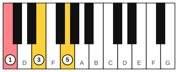
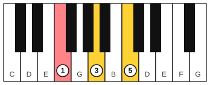
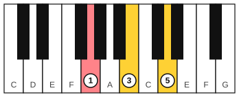
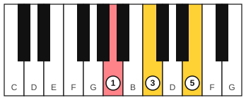

# Piano chord chart

Use this page to look up the notes of a chord when a chart gives you only its symbol. Every chord is listed with its root first, then the other notes going up.

## How to read the tables

The first cell is the chord symbol and the second cell lists its notes, lowest first when the chord is built up from the root. You can play the notes in any octave and in any order, and you can double a note (play it in two octaves). The root is the note the chord is named after.

Chords with a flat root use the flat name (Db, Eb, Ab, Bb). In the minor tables the two black-key roots that are usually written as sharps appear as C# and G#. Db and C# are the same key on the piano, so Db major and C#m sit side by side in practice.

Every row in a table has the same spacing, so once you know the shape for one chord, the other eleven follow. The [intervals and triads stage](../04-intervals-and-triads/index.md) and the [harmony stage](../09-harmony/index.md) teach how the chords are built.

## Major triads

A major triad is the root, the note 4 half steps up (the major 3rd) and the note 7 half steps up (the perfect 5th).

| Chord | Notes |
|---|---|
| C | C, E, G |
| Db | Db, F, Ab |
| D | D, F#, A |
| Eb | Eb, G, Bb |
| E | E, G#, B |
| F | F, A, C |
| F# | F#, A#, C# |
| G | G, B, D |
| Ab | Ab, C, Eb |
| A | A, C#, E |
| Bb | Bb, D, F |
| B | B, D#, F# |

## Minor triads

A minor triad lowers the middle note by one half step: the root, the note 3 half steps up (the minor 3rd) and the note 7 half steps up.

| Chord | Notes |
|---|---|
| Cm | C, Eb, G |
| C#m | C#, E, G# |
| Dm | D, F, A |
| Ebm | Eb, Gb, Bb |
| Em | E, G, B |
| Fm | F, Ab, C |
| F#m | F#, A, C# |
| Gm | G, Bb, D |
| G#m | G#, B, D# |
| Am | A, C, E |
| Bbm | Bb, Db, F |
| Bm | B, D, F# |

## Dominant 7th chords

A dominant 7th chord is a major triad plus the note 10 half steps above the root (the minor 7th). The symbol is the root with a 7, as in G7.

| Chord | Notes |
|---|---|
| C7 | C, E, G, Bb |
| Db7 | Db, F, Ab, Cb |
| D7 | D, F#, A, C |
| Eb7 | Eb, G, Bb, Db |
| E7 | E, G#, B, D |
| F7 | F, A, C, Eb |
| F#7 | F#, A#, C#, E |
| G7 | G, B, D, F |
| Ab7 | Ab, C, Eb, Gb |
| A7 | A, C#, E, G |
| Bb7 | Bb, D, F, Ab |
| B7 | B, D#, F#, A |

## Major 7th chords

A major 7th chord is a major triad plus the note 11 half steps above the root (the major 7th), one half step below the next root up.

| Chord | Notes |
|---|---|
| Cmaj7 | C, E, G, B |
| Dbmaj7 | Db, F, Ab, C |
| Dmaj7 | D, F#, A, C# |
| Ebmaj7 | Eb, G, Bb, D |
| Emaj7 | E, G#, B, D# |
| Fmaj7 | F, A, C, E |
| F#maj7 | F#, A#, C#, E# |
| Gmaj7 | G, B, D, F# |
| Abmaj7 | Ab, C, Eb, G |
| Amaj7 | A, C#, E, G# |
| Bbmaj7 | Bb, D, F, A |
| Bmaj7 | B, D#, F#, A# |

## Minor 7th chords

A minor 7th chord is a minor triad plus the minor 7th, 10 half steps above the root.

| Chord | Notes |
|---|---|
| Cm7 | C, Eb, G, Bb |
| C#m7 | C#, E, G#, B |
| Dm7 | D, F, A, C |
| Ebm7 | Eb, Gb, Bb, Db |
| Em7 | E, G, B, D |
| Fm7 | F, Ab, C, Eb |
| F#m7 | F#, A, C#, E |
| Gm7 | G, Bb, D, F |
| G#m7 | G#, B, D#, F# |
| Am7 | A, C, E, G |
| Bbm7 | Bb, Db, F, Ab |
| Bm7 | B, D, F#, A |

## The C, F, G and Am triads on the keyboard

Each figure shows the root in salmon and the right-hand fingers 1, 3 and 5 on the three notes.

