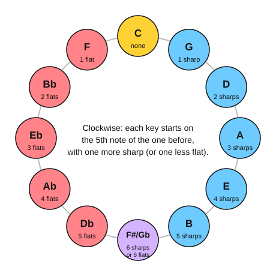

# Scales and key signatures

Use this page to look up a key signature, the spelling of a scale, or the order of keys around the circle of fifths.

## The circle of fifths

Each step clockwise adds one sharp (or removes one flat). Each step anticlockwise adds one flat (or removes one sharp). F# major and Gb major at the bottom are the same keys on the piano with different names.

## All 15 major keys and their key signatures

A **key signature** is the set of sharps or flats printed at the start of every staff, so the sharps and flats don't have to be written beside each note. The sharps always come in the order F#, C#, G#, D#, A#, E#, B#, and the flats in the order Bb, Eb, Ab, Db, Gb, Cb, Fb. A **relative minor** starts on the 6th note of the major scale and shares its key signature.

| Major key | Key signature | Sharps or flats | Relative minor |
|---|---|---|---|
| C major | none | none | A minor |
| G major | 1 sharp | F# | E minor |
| D major | 2 sharps | F#, C# | B minor |
| A major | 3 sharps | F#, C#, G# | F# minor |
| E major | 4 sharps | F#, C#, G#, D# | C# minor |
| B major | 5 sharps | F#, C#, G#, D#, A# | G# minor |
| F# major | 6 sharps | F#, C#, G#, D#, A#, E# | D# minor |
| C# major | 7 sharps | F#, C#, G#, D#, A#, E#, B# | A# minor |
| F major | 1 flat | Bb | D minor |
| Bb major | 2 flats | Bb, Eb | G minor |
| Eb major | 3 flats | Bb, Eb, Ab | C minor |
| Ab major | 4 flats | Bb, Eb, Ab, Db | F minor |
| Db major | 5 flats | Bb, Eb, Ab, Db, Gb | Bb minor |
| Gb major | 6 flats | Bb, Eb, Ab, Db, Gb, Cb | Eb minor |
| Cb major | 7 flats | Bb, Eb, Ab, Db, Gb, Cb, Fb | Ab minor |

To find the major key from a sharp key signature, go up one half step from the last sharp. To find it from a flat key signature, the second-to-last flat is the key (with one flat, the key is F major).

## Major scales

Each major scale follows the pattern whole, whole, half, whole, whole, whole, half (the steps between neighbouring notes). Each is written with eight notes, ending on the tonic an octave higher.

| Scale | Notes |
|---|---|
| C major | C D E F G A B C |
| G major | G A B C D E F# G |
| D major | D E F# G A B C# D |
| A major | A B C# D E F# G# A |
| E major | E F# G# A B C# D# E |
| B major | B C# D# E F# G# A# B |
| F# major | F# G# A# B C# D# E# F# |
| C# major | C# D# E# F# G# A# B# C# |
| F major | F G A Bb C D E F |
| Bb major | Bb C D Eb F G A Bb |
| Eb major | Eb F G Ab Bb C D Eb |
| Ab major | Ab Bb C Db Eb F G Ab |
| Db major | Db Eb F Gb Ab Bb C Db |
| Gb major | Gb Ab Bb Cb Db Eb F Gb |
| Cb major | Cb Db Eb Fb Gb Ab Bb Cb |

## Natural minor scales

The natural minor scale uses the same notes as its relative major, starting on the 6th note. The pattern is whole, half, whole, whole, half, whole, whole.

| Scale | Notes |
|---|---|
| A natural minor | A B C D E F G A |
| E natural minor | E F# G A B C D E |
| B natural minor | B C# D E F# G A B |
| F# natural minor | F# G# A B C# D E F# |
| C# natural minor | C# D# E F# G# A B C# |
| G# natural minor | G# A# B C# D# E F# G# |
| D# natural minor | D# E# F# G# A# B C# D# |
| A# natural minor | A# B# C# D# E# F# G# A# |
| D natural minor | D E F G A Bb C D |
| G natural minor | G A Bb C D Eb F G |
| C natural minor | C D Eb F G Ab Bb C |
| F natural minor | F G Ab Bb C Db Eb F |
| Bb natural minor | Bb C Db Eb F Gb Ab Bb |
| Eb natural minor | Eb F Gb Ab Bb Cb Db Eb |
| Ab natural minor | Ab Bb Cb Db Eb Fb Gb Ab |

## Harmonic minor scales

The harmonic minor scale raises the 7th note of the natural minor scale by one half step. That gives a leading note (a note a half step below the tonic) and a gap of three half steps between the 6th and 7th notes.

| Scale | Notes |
|---|---|
| A harmonic minor | A B C D E F G# A |
| E harmonic minor | E F# G A B C D# E |
| B harmonic minor | B C# D E F# G A# B |
| F# harmonic minor | F# G# A B C# D E# F# |
| D harmonic minor | D E F G A Bb C# D |
| G harmonic minor | G A Bb C D Eb F# G |
| C harmonic minor | C D Eb F G Ab B C |
| F harmonic minor | F G Ab Bb C Db E F |

## Melodic minor scales

The melodic minor scale, as written going up, raises both the 6th and 7th notes of the natural minor scale. Going down, classical music usually plays the natural minor notes again.

| Scale | Notes |
|---|---|
| A melodic minor | A B C D E F# G# A |
| E melodic minor | E F# G A B C# D# E |
| B melodic minor | B C# D E F# G# A# B |
| F# melodic minor | F# G# A B C# D# E# F# |
| D melodic minor | D E F G A B C# D |
| G melodic minor | G A Bb C D E F# G |
| C melodic minor | C D Eb F G A B C |
| F melodic minor | F G Ab Bb C D E F |

## The modes on C

A **mode** is a scale with the same notes as a major scale, started from a different note. Here every mode starts on C, so you can compare each one with C major.

| Mode | Notes | Compared with C major |
|---|---|---|
| C Ionian | C D E F G A B C | the major scale |
| C Dorian | C D Eb F G A Bb C | b3 and b7 |
| C Phrygian | C Db Eb F G Ab Bb C | b2, b3, b6 and b7 |
| C Lydian | C D E F# G A B C | #4 |
| C Mixolydian | C D E F G A Bb C | b7 |
| C Aeolian | C D Eb F G Ab Bb C | b3, b6 and b7 (the natural minor scale) |
| C Locrian | C Db Eb F Gb Ab Bb C | b2, b3, b5, b6 and b7 |

## The minor pentatonic scale

The minor pentatonic scale has five notes: the 1st, b3, 4th, 5th and b7 of the natural minor scale. Stage 12 has the guitar boxes for it.

| Scale | Notes |
|---|---|
| A minor pentatonic | A C D E G A |
| E minor pentatonic | E G A B D E |
